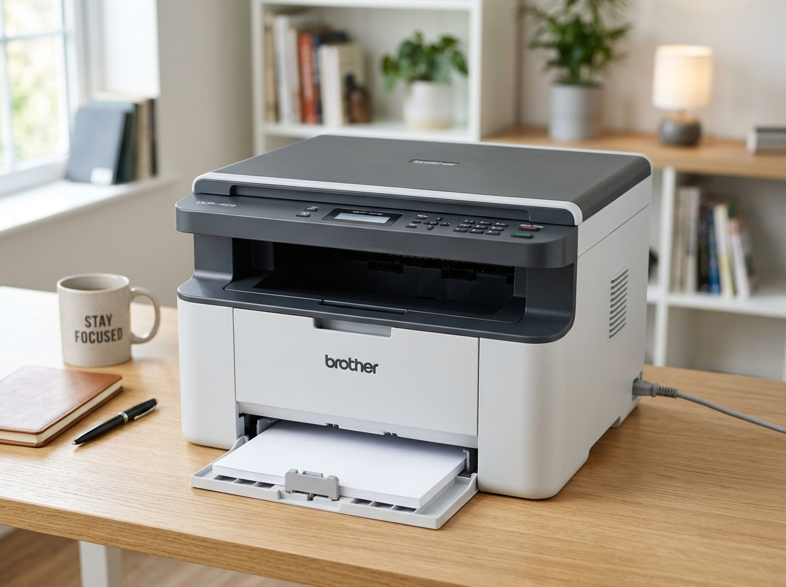
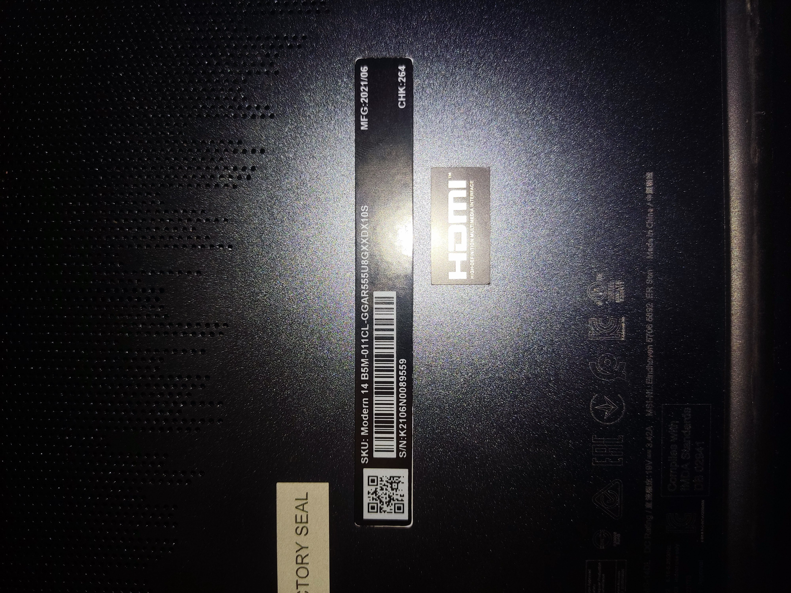
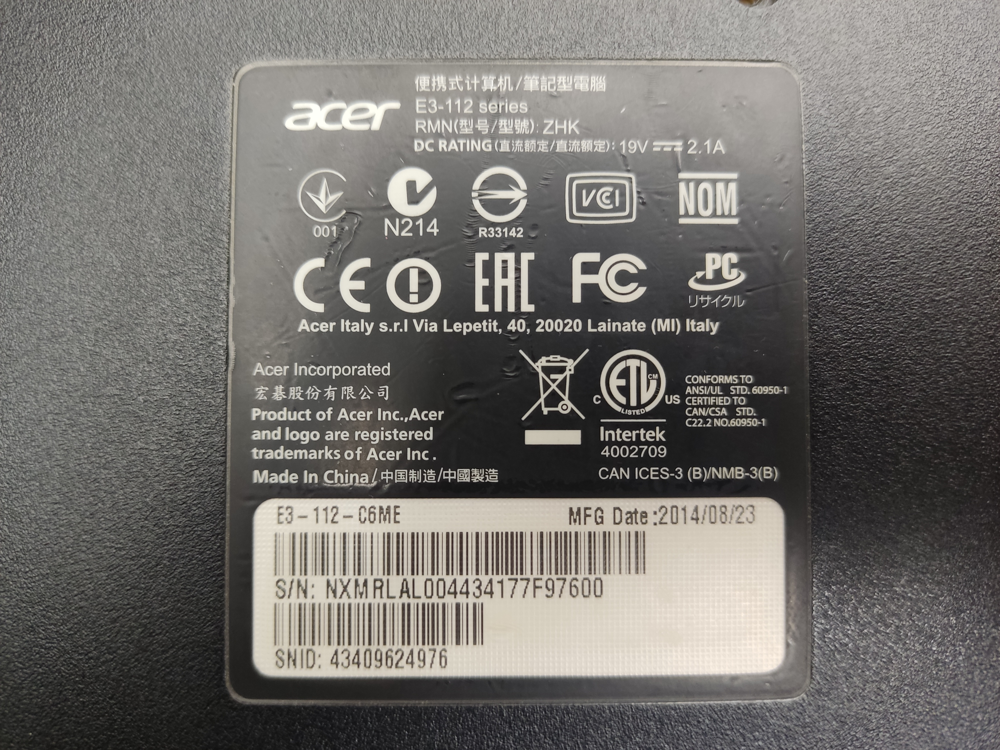
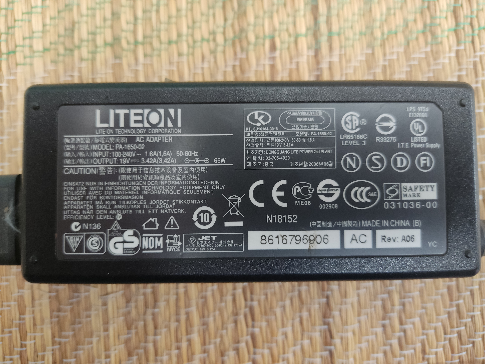

# Contexto del Proyecto: HomeInfra - Inventario de Equipos Personales

## 📌 Descripción General
Este archivo documenta el registro y contexto de los equipos tecnológicos personales de **HomeInfra**, incluyendo especificaciones clave (marca, modelo, tipo de equipo), número de serie o activo, responsable o ubicación física, imágenes de referencia de los equipos, especificaciones técnicas de hardware (**CPU**, **RAM**, **GPU**), **credenciales de acceso de Windows (Usuario y Contraseña)**, **observaciones técnicas e historial**, y enlaces directos para la descarga de controladores (drivers) oficiales.

La base de datos principal estructurada reside en el archivo [`equipos.json`](equipos.json) y se administra interactivamente a través de la aplicación web local `HomeInfra` (`index.html`, `style.css`, `app.js`).

*Última actualización sincronizada:* `2026-10-31` | *Total de equipos:* **4**

---

## ⚠️ Directiva de Desarrollo y Alcance (Regla Estricta)
> **REGLA FUNDAMENTAL:**
> Evitar estrictamente cambiar, crear o implementar funcionalidades, textos o componentes que no vayan en directa y exclusiva relación con lo que el usuario solicita puntualmente.
> - No asumir requerimientos no pedidos.
> - No agregar elementos estéticos ni funcionales que no hayan sido solicitados expresamente.
> - No alterar partes del sistema ni comportamientos fuera del alcance directo de la petición actual.

---

## 🧩 Visión: Gestión de Infraestructura basada en ITIL (Planificado)

> **Estado:** Implementación parcial. Los equipos ya guardan sus piezas en el campo `components` (categoría, modelo, serie, capacidad, si es reemplazable y, para accesorios registrados aparte como un cargador, el `deviceId` del equipo relacionado). Faltan la vista de componentes en la interfaz, los estados del ciclo de vida y el historial de cambios.

HomeInfra evolucionará de un inventario de equipos a un sistema de gestión de infraestructura alineado con las prácticas de **ITIL** (Gestión de Activos y de la Configuración). Además de equipos completos, registrará **partes de computadores** (RAM, HDD/SSD, fuentes, tarjetas), **equipos de red** (routers, switches, puntos de acceso), **módulos** y otros elementos de infraestructura.

### Elementos de Configuración (CI)
- Cada elemento registrado (equipo, pieza, módulo o equipo de red) es un **Elemento de Configuración (CI)** con identidad propia: tipo, marca, modelo, número de serie, estado y fotos.
- Los CI forman una **base de datos de configuración (CMDB)** que refleja qué existe y cómo se relaciona.

### Equipos compuestos y piezas
- Un equipo que contiene piezas (por ejemplo, un notebook) es un **CI padre**, y sus piezas son **CI hijos** relacionados con él.
- Se distinguen dos clases de piezas:
  - **Componentes integrados:** no reemplazables, forman parte fija del equipo (por ejemplo, CPU soldada, GPU integrada o RAM soldada a la placa). Se registran como parte del equipo.
  - **Piezas reemplazables:** se gestionan por separado (por ejemplo, módulos de RAM SO-DIMM, HDD/SSD, tarjeta Wi-Fi, batería). Pueden instalarse, retirarse o moverse entre equipos.
- Una pieza reemplazable conserva su identidad aunque cambie de equipo o quede guardada sin instalar.

### Ciclo de vida de las piezas
- Estados previstos: **En stock**, **Instalada**, **En reparación**, **Retirada** y **Dada de baja**.
- Cada pieza registra en qué equipo está instalada actualmente, si corresponde.

### Gestión de Cambios
- Cada intervención sobre un equipo (por ejemplo, cambiar el HDD por un SSD o ampliar la RAM) se registra como un **cambio**: fecha, motivo, pieza retirada, pieza instalada y observaciones.
- El historial de cambios permite saber la configuración actual y pasada de cada equipo.

### Ejemplo
**MSI Modern 14 B5M-011CL** (CI padre):
- Integrados: CPU AMD Ryzen 5 5500U, GPU AMD Radeon Graphics.
- Reemplazables (gestionados por separado): unidad de almacenamiento, tarjeta Wi-Fi Intel AX200 y módulos de RAM, si no van soldados a la placa.
- Si se reemplaza la unidad de almacenamiento, la unidad anterior pasa a **En stock** o **Dada de baja**, la nueva queda **Instalada** en el notebook y el cambio queda registrado en su historial.

---

## 💻 Resumen de Equipos Registrados

| # | Tipo | Marca | Modelo | Fabricación / Lanzamiento | CPU | RAM | GPU | Usuario Windows | Serie / Activo | Enlace a Drivers / Soporte |
|---|------|-------|--------|---------------------------|-----|-----|-----|-----------------|----------------|----------------------------|
| 1 | Impresora | Brother | DCP-1602 | 2015 | N/A | N/A | N/A | N/A | N/A | [Soporte Oficial Brother DCP-1602](Devices/Brother%20DCP-1602/Y14G_C1_U-inst-B1.EXE) |
| 2 | Laptop | MSI | Modern 14 B5M-011CL | 2021-06 | AMD Ryzen 5 5500U [2021] | 8 GB | AMD Radeon Graphics (Integrada) | N/A | K2106N0089559 | [Soporte Oficial MSI Modern 14 B5M-011CL](https://www.msi.com/Business-Productivity/Modern-14-B5SX/support) |
| 3 | Laptop | Acer | Aspire E3-112-C6ME | 2014-08-23 | N/A | N/A | N/A | N/A | NXMRLAL004434177F97600 | [Soporte Oficial Acer Aspire E3-112-C6ME](https://www.acer.com/latam-es/support/product-support/E3-112) |
| 4 | Periférico | Lite-On | PA-1650-02 (Adaptador AC 65W) | 2008-06 | N/A | N/A | N/A | N/A | AP06503016824OB7E6P606 | [Soporte Oficial Lite-On PA-1650-02 (Adaptador AC 65W)](https://www.acer.com/latam-es/support/product-support/E3-112) |

---

## 📋 Fichas Técnicas Detalladas de Equipos

### 1. Brother DCP-1602

- **Tipo:** Impresora
- **Marca:** Brother
- **Modelo:** DCP-1602
- **Número de Serie / Activo:** No registrado
- **Fecha de Fabricación / Lanzamiento:** 2015
- **Usuario(s) Asignado(s):** Rodrigo
- **Asignación / Ubicación:** Hogar
- **Enlace de Drivers:** [Soporte Oficial Brother DCP-1602](Devices/Brother%20DCP-1602/Y14G_C1_U-inst-B1.EXE)
- **Notas:** Multifuncional láser monocromática (impresora, copiadora y escáner de cama plana). Conectividad USB 2.0 de alta velocidad. Velocidad de impresión hasta 20 ppm. Resolución de hasta 2400 x 600 dpi.
- **Control de Consumibles y Mantenimiento:**
  - **Tóner (Brother TN-1060):**
    - *Último aviso de fin de tóner:* Sin registro
    - *Último reemplazo de tóner:* Sin registro
  - **Tambor / Drum (Brother DR-1060):**
    - *Último aviso de fin de tambor:* Sin registro
    - *Último reemplazo de tambor:* Sin registro
- **Observaciones:** Equipo multifuncional personal de Rodrigo. Utiliza cartucho de tóner Brother TN-1060 (~1.000 páginas) y unidad de tambor Brother DR-1060 (~10.000 páginas).

Archivos Locales Guardados (Carpeta Devices):
• [Instalador Paquete Completo de Controladores y Software (Y14G_C1_U-inst-B1.EXE)](Devices/Brother%20DCP-1602/Y14G_C1_U-inst-B1.EXE) (279.5 MB)
• [Instalador Brother iPrint&Scan (iPrintScan-Setup-17_0_20_2.exe)](Devices/Brother%20DCP-1602/iPrintScan-Setup-17_0_20_2.exe) (370.4 MB)

Enlaces Oficiales Web (Respaldo en Línea):
• [Descargar Paquete Completo Oficial (Brother Web)](https://support.brother.com/g/b/downloadhowto.aspx?c=mx&lang=es&prod=dcp1602_us&os=10068&dlid=dlf106152_000&flang=27&type3=11)
• [Descargar Brother iPrint&Scan Oficial (Brother Web)](https://support.brother.com/g/b/downloadhowto.aspx?c=us_ot&lang=en&prod=dcpt420w_all&os=10068&dlid=dlf106359_000&flang=4&type3=10272)

### 2. MSI Modern 14 B5M-011CL

- **Tipo:** Laptop
- **Marca:** MSI
- **Modelo:** Modern 14 B5M-011CL
- **Número de Serie / Activo:** K2106N0089559
- **Fecha de Fabricación / Lanzamiento:** 2021-06
- **Asignación / Ubicación:** Hogar
- **Especificaciones de Hardware:**
  - **Procesador (CPU):** AMD Ryzen 5 5500U
    - *Núcleos e Hilos:* 6 núcleos / 12 hilos
    - *Frecuencia:* 2.1 - 4.0 GHz
    - *Año de salida:* 2021
    - *Características:* Deducido del SKU (GGAR555U)
  - **Memoria RAM:** 8 GB 
    - *Configuración:* Deducido del SKU (U8G)
  - **Tarjeta Gráfica (GPU):** AMD Radeon Graphics
    - *Tipo:* **Integrada**
    - *Características:* Integrada en el Ryzen 5 5500U
- **Enlace de Drivers:** [Soporte Oficial MSI Modern 14 B5M-011CL](https://www.msi.com/Business-Productivity/Modern-14-B5SX/support)
- **Notas:** Notebook MSI Modern 14 (Model No. MS-14DL). Wi-Fi Intel Wi-Fi 6 AX200 (AX200NGW). Alimentación DC 19V ⎓ 3.42A.
- **Observaciones:** Datos de la etiqueta inferior:
• SKU: Modern 14 B5M-011CL-GGAR555U8GXXDX10S
• S/N: K2106N0089559
• MFG: 2021/06
• CHK: 264
• Model No.: MS-14DL
• DC Rating: 19V ⎓ 3.42A
• Wi-Fi: Intel Wi-Fi 6 AX200 (Model AX200NGW)

CPU, RAM y GPU deducidos del SKU (R555U = AMD Ryzen 5 5500U, 8G = 8 GB RAM); pendiente confirmar en el equipo. Almacenamiento no registrado.

La etiqueta del número de serie está desgastada (ver fotos 2026); la foto de 2023 conserva la lectura completa.
- **Fotografías:**
  - Etiqueta SKU / S/N (2023): [`img/msi_modern14_etiqueta_2023.jpg`](img/msi_modern14_etiqueta_2023.jpg)
  - Etiqueta SKU / S/N (2026, desgastada): [`img/msi_modern14_etiqueta_2026.jpg`](img/msi_modern14_etiqueta_2026.jpg)
  - MFG 2021/06 · CHK 264: [`img/msi_modern14_fabricacion.jpg`](img/msi_modern14_fabricacion.jpg)
  - Model No. MS-14DL: [`img/msi_modern14_modelo_ms14dl.jpg`](img/msi_modern14_modelo_ms14dl.jpg)
  - DC Rating 19V 3.42A: [`img/msi_modern14_alimentacion.jpg`](img/msi_modern14_alimentacion.jpg)
  - Wi-Fi Intel AX200: [`img/msi_modern14_wifi_ax200.jpg`](img/msi_modern14_wifi_ax200.jpg)

### 3. Acer Aspire E3-112-C6ME

- **Tipo:** Laptop
- **Marca:** Acer
- **Modelo:** Aspire E3-112-C6ME
- **Número de Serie / Activo:** NXMRLAL004434177F97600
- **Fecha de Fabricación / Lanzamiento:** 2014-08-23
- **Asignación / Ubicación:** Hogar
- **Enlace de Drivers:** [Soporte Oficial Acer Aspire E3-112-C6ME](https://www.acer.com/latam-es/support/product-support/E3-112)
- **Notas:** Notebook Acer Aspire E3-112 series (RMN ZHK). Wi-Fi + Bluetooth combo QCWB335. Alimentación DC 19V ⎓ 2.1A.
- **Observaciones:** Datos de la etiqueta inferior:
• Modelo: E3-112-C6ME (E3-112 series)
• S/N: NXMRLAL004434177F97600
• SNID: 43409624976
• MFG Date: 2014/08/23
• RMN: ZHK
• DC Rating: 19V ⎓ 2.1A
• WLAN + Bluetooth: QCWB335 (FCC ID PPD-QCWB335)

Cargador asignado: Lite-On PA-1650-02 (19V ⎓ 3.42A, 65W), S/N AP06503016824OB7E6P606. Registrado como equipo aparte (dev-acer-e3-112-cargador).

CPU, RAM y almacenamiento no figuran en las etiquetas; pendiente registrarlos con el HomeInfra Collector.
- **Componentes:**
  - *Red:* WLAN + Bluetooth combo QCWB335 (FCC ID PPD-QCWB335) · reemplazable
  - *Cargador:* Lite-On PA-1650-02 65 W (19V ⎓ 3.42A) · S/N AP06503016824OB7E6P606 · reemplazable · equipo relacionado: `dev-acer-e3-112-cargador`
- **Fotografías:**
  - Etiqueta modelo / S/N / MFG: [`img/acer_e3-112_etiqueta_serie.jpg`](img/acer_e3-112_etiqueta_serie.jpg)
  - Etiqueta WLAN + Bluetooth QCWB335: [`img/acer_e3-112_etiqueta_wifi_qcwb335.jpg`](img/acer_e3-112_etiqueta_wifi_qcwb335.jpg)
  - Cargador: etiqueta Lite-On PA-1650-02: [`img/acer_e3-112_cargador_etiqueta_liteon_pa-1650-02.jpg`](img/acer_e3-112_cargador_etiqueta_liteon_pa-1650-02.jpg)
  - Cargador: vista general: [`img/acer_e3-112_cargador_vista_general.jpg`](img/acer_e3-112_cargador_vista_general.jpg)

### 4. Lite-On PA-1650-02 (Adaptador AC 65W)

- **Tipo:** Periférico
- **Marca:** Lite-On
- **Modelo:** PA-1650-02 (Adaptador AC 65W)
- **Número de Serie / Activo:** AP06503016824OB7E6P606
- **Fecha de Fabricación / Lanzamiento:** 2008-06
- **Asignación / Ubicación:** Hogar
- **Enlace de Drivers:** [Soporte Oficial Lite-On PA-1650-02 (Adaptador AC 65W)](https://www.acer.com/latam-es/support/product-support/E3-112)
- **Notas:** Cargador del Acer Aspire E3-112-C6ME (S/N NXMRLAL004434177F97600). Entrada 100-240V ~ 1.6A 50-60Hz. Salida 19V ⎓ 3.42A, 65W, centro positivo. Conector de punta amarilla.
- **Observaciones:** Datos de la etiqueta:
• Fabricante: Lite-On Technology Corporation
• Modelo: PA-1650-02
• Entrada: 100-240V ~ 1.6A, 50-60Hz
• Salida: 19V ⎓ 3.42A, 65W (centro positivo)
• Fecha de fabricación: 2008/06
• Etiqueta de serie: 8616796906 · AC · Rev: A06
• Código de barras ADT: AP06503016824OB7E6P606

Compatibilidad: el notebook requiere 19V ⎓ 2.1A; este cargador entrega el mismo voltaje con mayor corriente disponible (3.42A), por lo que es compatible. Por su fecha de fabricación (2008) no es el cargador de fábrica del notebook (2014).

Equipo asociado: Acer Aspire E3-112-C6ME (dev-acer-e3-112).
- **Fotografías:**
  - Etiqueta Lite-On PA-1650-02: [`img/acer_e3-112_cargador_etiqueta_liteon_pa-1650-02.jpg`](img/acer_e3-112_cargador_etiqueta_liteon_pa-1650-02.jpg)
  - Código de barras ADT (serie): [`img/acer_e3-112_cargador_serie_ap06503.jpg`](img/acer_e3-112_cargador_serie_ap06503.jpg)
  - Etiqueta de advertencia de temperatura: [`img/acer_e3-112_cargador_advertencia_temperatura.jpg`](img/acer_e3-112_cargador_advertencia_temperatura.jpg)
  - Vista general con cable y conector: [`img/acer_e3-112_cargador_vista_general.jpg`](img/acer_e3-112_cargador_vista_general.jpg)

---

## 🛠️ Guía de Uso del Inventario y Driver Hub
1. **Base de Datos:** El archivo [`equipos.json`](equipos.json) almacena los registros de los equipos, imágenes de referencia, especificaciones de hardware, credenciales y observaciones.
2. **Abrir la Aplicación:** Abre `index.html` en cualquier navegador web.
3. **Registro y Edición:** Pulsa en **"Registrar Equipo"** o en el botón de **Editar** (icono de lápiz) en cualquier tarjeta para modificar cualquier campo en cualquier momento.
4. **Acceso Rápido a Drivers:** Desde la tarjeta de cada equipo, el botón **"Descargar Drivers & Soporte"** te llevará directamente a la página oficial de descargas del fabricante.
5. **Sincronización:** Usa el botón **"Descargar contexto.md"**, **"Sincronizar contexto.md"** o **"Copiar Markdown"** en la barra superior para actualizar este archivo cada vez que ingreses o modifiques equipos.
6. **HomeInfra Collector:** El botón **"Collector"** muestra el comando para recolectar los datos de un equipo en Windows, Linux o macOS, y permite importar los registros `.json` generados (varios a la vez). El script también puede llevarse en un pendrive desde la carpeta [`Collector`](Collector/README.md).
7. **Equipos nuevos desde equipos.json:** Al abrir la app, los equipos de `equipos.json` que el navegador aún no conoce se agregan solos; los eliminados desde la app no vuelven a aparecer.
