# Contexto del Proyecto: HomeInfra - Inventario de Equipos Personales

## 📌 Descripción General
Este archivo documenta el registro y contexto de los equipos tecnológicos personales de **HomeInfra**, incluyendo especificaciones clave (marca, modelo, tipo de equipo), número de serie o activo, responsable o ubicación física, imágenes de referencia de los equipos, especificaciones técnicas de hardware (**CPU**, **RAM**, **GPU**), **credenciales de acceso de Windows (Usuario y Contraseña)**, **observaciones técnicas e historial**, y enlaces directos para la descarga de controladores (drivers) oficiales.

La base de datos principal estructurada reside en el archivo [`equipos.json`](equipos.json) y se administra interactivamente a través de la aplicación web local `HomeInfra` (`index.html`, `style.css`, `app.js`).

*Última actualización sincronizada:* `2026-11-02` | *Total de equipos:* **21**

---

## ⚠️ Directiva de Desarrollo y Alcance (Regla Estricta)
> **REGLA FUNDAMENTAL:**
> Evitar estrictamente cambiar, crear o implementar funcionalidades, textos o componentes que no vayan en directa y exclusiva relación con lo que el usuario solicita puntualmente.
> - No asumir requerimientos no pedidos.
> - No agregar elementos estéticos ni funcionales que no hayan sido solicitados expresamente.
> - No alterar partes del sistema ni comportamientos fuera del alcance directo de la petición actual.

---

## 🧩 Visión: Gestión de Infraestructura basada en ITIL (Planificado)

> **Estado:** Implementación parcial. Los equipos ya guardan sus piezas en el campo `components` (categoría, modelo, serie, capacidad, si es reemplazable y, para accesorios registrados aparte como un cargador, el `deviceId` del equipo relacionado). Faltan la vista de componentes en la interfaz, los estados del ciclo de vida y el historial de cambios.

HomeInfra evolucionará de un inventario de equipos a un sistema de gestión de infraestructura alineado con las prácticas de **ITIL** (Gestión de Activos y de la Configuración). Además de equipos completos, registrará **partes de computadores** (RAM, HDD/SSD, fuentes, tarjetas), **equipos de red** (routers, switches, puntos de acceso), **módulos** y otros elementos de infraestructura.

### Elementos de Configuración (CI)
- Cada elemento registrado (equipo, pieza, módulo o equipo de red) es un **Elemento de Configuración (CI)** con identidad propia: tipo, marca, modelo, número de serie, estado y fotos.
- Los CI forman una **base de datos de configuración (CMDB)** que refleja qué existe y cómo se relaciona.

### Equipos compuestos y piezas
- Un equipo que contiene piezas (por ejemplo, un notebook) es un **CI padre**, y sus piezas son **CI hijos** relacionados con él.
- Se distinguen dos clases de piezas:
  - **Componentes integrados:** no reemplazables, forman parte fija del equipo (por ejemplo, CPU soldada, GPU integrada o RAM soldada a la placa). Se registran como parte del equipo.
  - **Piezas reemplazables:** se gestionan por separado (por ejemplo, módulos de RAM SO-DIMM, HDD/SSD, tarjeta Wi-Fi, batería). Pueden instalarse, retirarse o moverse entre equipos.
- Una pieza reemplazable conserva su identidad aunque cambie de equipo o quede guardada sin instalar.

### Ciclo de vida de las piezas
- Estados previstos: **En stock**, **Instalada**, **En reparación**, **Retirada** y **Dada de baja**.
- Cada pieza registra en qué equipo está instalada actualmente, si corresponde.

### Gestión de Cambios
- Cada intervención sobre un equipo (por ejemplo, cambiar el HDD por un SSD o ampliar la RAM) se registra como un **cambio**: fecha, motivo, pieza retirada, pieza instalada y observaciones.
- El historial de cambios permite saber la configuración actual y pasada de cada equipo.

### Ejemplo
**MSI Modern 14 B5M-011CL** (CI padre):
- Integrados: CPU AMD Ryzen 5 5500U, GPU AMD Radeon Graphics.
- Reemplazables (gestionados por separado): unidad de almacenamiento, tarjeta Wi-Fi Intel AX200 y módulos de RAM, si no van soldados a la placa.
- Si se reemplaza la unidad de almacenamiento, la unidad anterior pasa a **En stock** o **Dada de baja**, la nueva queda **Instalada** en el notebook y el cambio queda registrado en su historial.

---

## 💻 Resumen de Equipos Registrados

| # | Tipo | Marca | Modelo | Fabricación / Lanzamiento | CPU | RAM | GPU | Usuario Windows | Serie / Activo | Enlace a Drivers / Soporte |
|---|------|-------|--------|---------------------------|-----|-----|-----|-----------------|----------------|----------------------------|
| 1 | Impresora | Brother | DCP-1602 | 2015 | N/A | N/A | N/A | N/A | N/A | [Soporte Oficial Brother DCP-1602](Devices/Brother%20DCP-1602/Y14G_C1_U-inst-B1.EXE) |
| 2 | Laptop | MSI | Modern 14 B5M-011CL | 2021-06 | AMD Ryzen 5 5500U [2021] | 8 GB | AMD Radeon Graphics (Integrada) | N/A | K2106N0089559 | [Soporte Oficial MSI Modern 14 B5M-011CL](https://www.msi.com/Business-Productivity/Modern-14-B5SX/support) |
| 3 | Laptop | Acer | Aspire E3-112-C6ME | 2014-08-23 | N/A | N/A | N/A | N/A | NXMRLAL004434177F97600 | [Soporte Oficial Acer Aspire E3-112-C6ME](https://www.acer.com/latam-es/support/product-support/E3-112) |
| 4 | Periférico | Lite-On | PA-1650-02 (Adaptador AC 65W) | 2008-06 | N/A | N/A | N/A | N/A | AP06503016824OB7E6P606 | [Soporte Oficial Lite-On PA-1650-02 (Adaptador AC 65W)](https://www.acer.com/latam-es/support/product-support/E3-112) |
| 5 | Desktop | PC armado | Core i5-12400F · MSI PRO H610M-G DDR4 | 2022 (lanzamiento de la plataforma Intel H610) | 12th Gen Intel(R) Core(TM) i5-12400F [2022] | 16 GB DDR4 | NVIDIA GeForce GTX 1660 SUPER (Dedicada) | N/A | 07D4612_M21D142444 | [Soporte Oficial PC armado Core i5-12400F · MSI PRO H610M-G DDR4](https://www.msi.com/Motherboard/PRO-H610M-G-DDR4/support) |
| 6 | Desktop | PC armado | Core 2 Quad Q6700 · ASUS P5G41T-M LX | 2008 (lanzamiento del chipset Intel G41) | Intel(R) Core(TM)2 Quad CPU Q6700 @ 2.66GHz [2007] | 8 GB DDR3 | Intel(R) G41 Express Chipset (Microsoft Corporation - WDDM 1.1) (Integrada) | N/A | 107933150000113 | [Soporte Oficial PC armado Core 2 Quad Q6700 · ASUS P5G41T-M LX](https://www.asus.com/supportonly/p5g41t-m%20lx/helpdesk_download/) |
| 7 | Desktop | PC armado | Core 2 Duo E6750 · ASUS P5Q PRO TURBO | 2008 (lanzamiento del chipset Intel P45) | Intel(R) Core(TM)2 Duo CPU E6750 @ 2.66GHz [2007] | 4 GB DDR2 | NVIDIA GeForce 210 (Dedicada) | N/A | MS1C93BC3400692 | [Soporte Oficial PC armado Core 2 Duo E6750 · ASUS P5Q PRO TURBO](https://www.asus.com/supportonly/p5q%20pro%20turbo/helpdesk_download/) |
| 8 | Desktop | PC armado | Core i7-2600K · Gigabyte Z77-HD3 | 2012 (lanzamiento del chipset Intel Z77) | Intel(R) Core(TM) i7-2600K CPU @ 3.40GHz [2011] | 16 GB DDR3 | Intel(R) HD Graphics 3000 (Integrada) | N/A | N/A | [Soporte Oficial PC armado Core i7-2600K · Gigabyte Z77-HD3](https://www.gigabyte.com/Motherboard/GA-Z77-HD3-rev-10/support) |
| 9 | Monitor | LG | TV (usado como monitor) | 2010 | N/A | N/A | N/A | N/A | N/A | [Soporte Oficial LG TV (usado como monitor)](https://www.google.com/search?q=LG%20TV%20monitor%20soporte%20oficial) |
| 10 | Periférico | Patriot | Burst Elite 120GB (SSD de Windows compartido) | N/A | N/A | N/A | N/A | N/A | PBEIIBB21030118778 | [Soporte Oficial Patriot Burst Elite 120GB (SSD de Windows compartido)](https://www.google.com/search?q=Patriot%20Burst%20Elite%20120GB%20SSD%20soporte) |
| 11 | Periférico | Patriot | Burst Elite 120GB (segunda unidad) | N/A | N/A | N/A | N/A | N/A | N/A | [Soporte Oficial Patriot Burst Elite 120GB (segunda unidad)](https://www.google.com/search?q=Patriot%20Burst%20Elite%20120GB%20SSD%20soporte) |
| 12 | Periférico | Sony | Pendrive USB 4 GB (HomeInfra Collector) | N/A | N/A | N/A | N/A | N/A | 7B2211109146005852 | [Soporte Oficial Sony Pendrive USB 4 GB (HomeInfra Collector)](https://www.google.com/search?q=Sony%20USB%20flash%20drive%20soporte) |
| 13 | Periférico | ZOTAC | GeForce 8400 GS GEN2 512MB DDR2 | 2007 (lanzamiento de la GeForce 8400 GS) | N/A | N/A | NVIDIA GeForce 8400 GS (Dedicada) | N/A | N103100027911 | [Soporte Oficial ZOTAC GeForce 8400 GS GEN2 512MB DDR2](https://www.nvidia.com/Download/index.aspx?lang=es) |
| 14 | Desktop | PC armado | MSI A68HM-E33 V2 (CPU AMD por identificar) | 2014 (lanzamiento del chipset AMD A68H) | N/A | N/A | N/A | N/A | G716320033 33004 | [Soporte Oficial PC armado MSI A68HM-E33 V2 (CPU AMD por identificar)](https://www.msi.com/Motherboard/A68HM-E33-V2/support) |
| 15 | Periférico | Western Digital | WD Blue 1TB WD10SPZX (marcado 1) | 2018-12-14 | N/A | N/A | N/A | N/A | WXN1AA821XCH | [Soporte Oficial Western Digital WD Blue 1TB WD10SPZX (marcado 1)](https://www.westerndigital.com/support) |
| 16 | Periférico | Western Digital | WD Blue 1TB WD10JPVX (marcado 2) | 2017-02-10 | N/A | N/A | N/A | N/A | WX31A177YXJU | [Soporte Oficial Western Digital WD Blue 1TB WD10JPVX (marcado 2)](https://www.westerndigital.com/support) |
| 17 | Periférico | Seagate (Samsung) | Spinpoint M8 1TB ST1000LM024 (marcado 3) | 2011 (lanzamiento de la serie Spinpoint M8) | N/A | N/A | N/A | N/A | S32HJ9HF204858 | [Soporte Oficial Seagate (Samsung) Spinpoint M8 1TB ST1000LM024 (marcado 3)](https://www.seagate.com/support/) |
| 18 | Periférico | Toshiba | MQ01ACF050 500GB | 2014-05-24 | N/A | N/A | N/A | N/A | 54O9C6M8T | [Soporte Oficial Toshiba MQ01ACF050 500GB](https://www.toshiba-storage.com/) |
| 19 | Periférico | Western Digital | WD Blue 750GB WD7500BPVT | 2012-11-04 | N/A | N/A | N/A | N/A | WXD1E72EHP04 | [Soporte Oficial Western Digital WD Blue 750GB WD7500BPVT](https://www.westerndigital.com/support) |
| 20 | Periférico | Samsung | SSD 850 EVO 500GB | 2014 (lanzamiento del 850 EVO) | N/A | N/A | N/A | N/A | S21HNXAGA21889H | [Soporte Oficial Samsung SSD 850 EVO 500GB](https://semiconductor.samsung.com/consumer-storage/support/tools/) |
| 21 | Periférico | Inspur | Tarjeta RAID/HBA SAS 6Gb/s YZCA-00019-101 (chip LSI) | N/A | N/A | N/A | N/A | N/A | QTE227E00948A07 | [Soporte Oficial Inspur Tarjeta RAID/HBA SAS 6Gb/s YZCA-00019-101 (chip LSI)](https://www.broadcom.com/support/download-search) |

---

## 📋 Fichas Técnicas Detalladas de Equipos

### 1. Brother DCP-1602
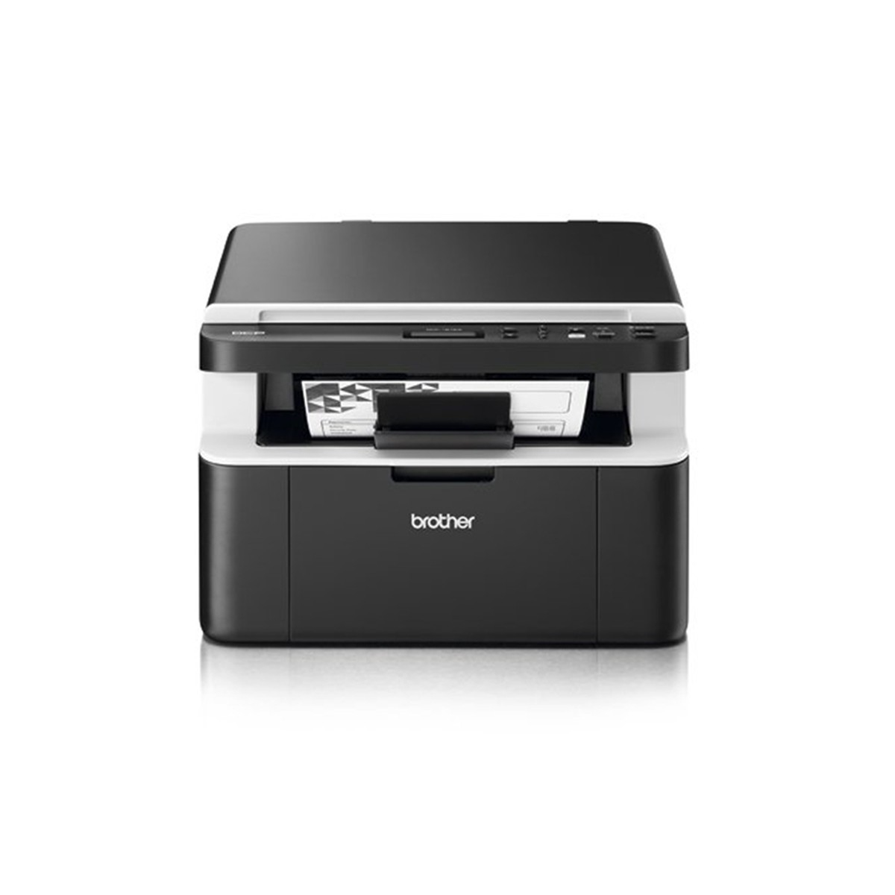

- **Tipo:** Impresora
- **Marca:** Brother
- **Modelo:** DCP-1602
- **Número de Serie / Activo:** No registrado
- **Fecha de Fabricación / Lanzamiento:** 2015
- **Usuario(s) Asignado(s):** Rodrigo
- **Asignación / Ubicación:** Hogar
- **Enlace de Drivers:** [Soporte Oficial Brother DCP-1602](Devices/Brother%20DCP-1602/Y14G_C1_U-inst-B1.EXE)
- **Notas:** Multifuncional láser monocromática (impresora, copiadora y escáner de cama plana). Conectividad USB 2.0 de alta velocidad. Velocidad de impresión hasta 20 ppm. Resolución de hasta 2400 x 600 dpi.
- **Control de Consumibles y Mantenimiento:**
  - **Tóner (Brother TN-1060):**
    - *Último aviso de fin de tóner:* Sin registro
    - *Último reemplazo de tóner:* Sin registro
  - **Tambor / Drum (Brother DR-1060):**
    - *Último aviso de fin de tambor:* Sin registro
    - *Último reemplazo de tambor:* Sin registro
- **Observaciones:** Equipo multifuncional personal de Rodrigo. Utiliza cartucho de tóner Brother TN-1060 (~1.000 páginas) y unidad de tambor Brother DR-1060 (~10.000 páginas).

Archivos Locales Guardados (Carpeta Devices):
• [Instalador Paquete Completo de Controladores y Software (Y14G_C1_U-inst-B1.EXE)](Devices/Brother%20DCP-1602/Y14G_C1_U-inst-B1.EXE) (279.5 MB)
• [Instalador Brother iPrint&Scan (iPrintScan-Setup-17_0_20_2.exe)](Devices/Brother%20DCP-1602/iPrintScan-Setup-17_0_20_2.exe) (370.4 MB)

Enlaces Oficiales Web (Respaldo en Línea):
• [Descargar Paquete Completo Oficial (Brother Web)](https://support.brother.com/g/b/downloadhowto.aspx?c=mx&lang=es&prod=dcp1602_us&os=10068&dlid=dlf106152_000&flang=27&type3=11)
• [Descargar Brother iPrint&Scan Oficial (Brother Web)](https://support.brother.com/g/b/downloadhowto.aspx?c=us_ot&lang=en&prod=dcpt420w_all&os=10068&dlid=dlf106359_000&flang=4&type3=10272)
- **Fotografías:**
  - Imagen comercial (Icecat): [`img/brother_dcp1602_comercial.jpg`](img/brother_dcp1602_comercial.jpg)
  - Imagen de referencia anterior (ilustración): [`img/brother_dcp1602.jpg`](img/brother_dcp1602.jpg)

### 2. MSI Modern 14 B5M-011CL
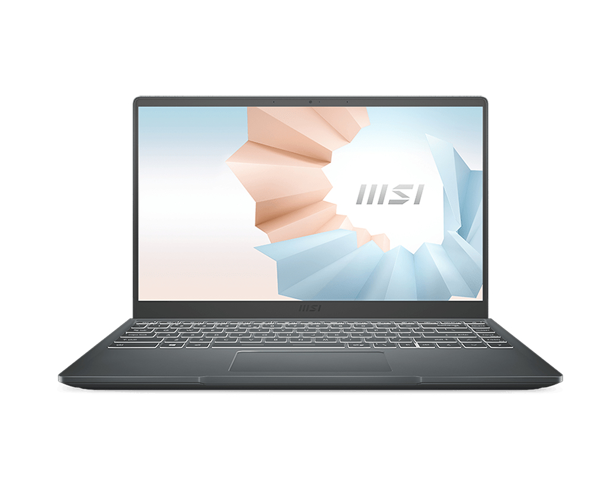

- **Tipo:** Laptop
- **Marca:** MSI
- **Modelo:** Modern 14 B5M-011CL
- **Número de Serie / Activo:** K2106N0089559
- **Fecha de Fabricación / Lanzamiento:** 2021-06
- **Asignación / Ubicación:** Hogar
- **Especificaciones de Hardware:**
  - **Procesador (CPU):** AMD Ryzen 5 5500U
    - *Núcleos e Hilos:* 6 núcleos / 12 hilos
    - *Frecuencia:* 2.1 - 4.0 GHz
    - *Año de salida:* 2021
    - *Características:* Deducido del SKU (GGAR555U)
    - *Benchmark PassMark:* multinúcleo 12.574 · mononúcleo 2.385 ([fuente](https://www.cpubenchmark.net/cpu.php?id=4141), 2026-11-01)
  - **Memoria RAM:** 8 GB 
    - *Configuración:* Deducido del SKU (U8G)
  - **Tarjeta Gráfica (GPU):** AMD Radeon Graphics
    - *Tipo:* **Integrada**
    - *Características:* Integrada en el Ryzen 5 5500U
- **Enlace de Drivers:** [Soporte Oficial MSI Modern 14 B5M-011CL](https://www.msi.com/Business-Productivity/Modern-14-B5SX/support)
- **Notas:** Notebook MSI Modern 14 (Model No. MS-14DL). Wi-Fi Intel Wi-Fi 6 AX200 (AX200NGW). Alimentación DC 19V ⎓ 3.42A.
- **Observaciones:** Datos de la etiqueta inferior:
• SKU: Modern 14 B5M-011CL-GGAR555U8GXXDX10S
• S/N: K2106N0089559
• MFG: 2021/06
• CHK: 264
• Model No.: MS-14DL
• DC Rating: 19V ⎓ 3.42A
• Wi-Fi: Intel Wi-Fi 6 AX200 (Model AX200NGW)

CPU, RAM y GPU deducidos del SKU (R555U = AMD Ryzen 5 5500U, 8G = 8 GB RAM); pendiente confirmar en el equipo. Almacenamiento no registrado.

La etiqueta del número de serie está desgastada (ver fotos 2026); la foto de 2023 conserva la lectura completa.
- **Fotografías:**
  - Imagen comercial (Icecat, Modern 14 B5M): [`img/msi_modern14_comercial.jpg`](img/msi_modern14_comercial.jpg)
  - Etiqueta SKU / S/N (2023): [`img/msi_modern14_etiqueta_2023.jpg`](img/msi_modern14_etiqueta_2023.jpg)
  - Etiqueta SKU / S/N (2026, desgastada): [`img/msi_modern14_etiqueta_2026.jpg`](img/msi_modern14_etiqueta_2026.jpg)
  - MFG 2021/06 · CHK 264: [`img/msi_modern14_fabricacion.jpg`](img/msi_modern14_fabricacion.jpg)
  - Model No. MS-14DL: [`img/msi_modern14_modelo_ms14dl.jpg`](img/msi_modern14_modelo_ms14dl.jpg)
  - DC Rating 19V 3.42A: [`img/msi_modern14_alimentacion.jpg`](img/msi_modern14_alimentacion.jpg)
  - Wi-Fi Intel AX200: [`img/msi_modern14_wifi_ax200.jpg`](img/msi_modern14_wifi_ax200.jpg)

### 3. Acer Aspire E3-112-C6ME
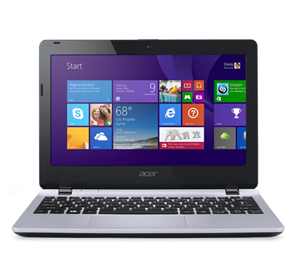

- **Tipo:** Laptop
- **Marca:** Acer
- **Modelo:** Aspire E3-112-C6ME
- **Número de Serie / Activo:** NXMRLAL004434177F97600
- **Fecha de Fabricación / Lanzamiento:** 2014-08-23
- **Asignación / Ubicación:** Hogar
- **Enlace de Drivers:** [Soporte Oficial Acer Aspire E3-112-C6ME](https://www.acer.com/latam-es/support/product-support/E3-112)
- **Notas:** Notebook Acer Aspire E3-112 series (RMN ZHK). Wi-Fi + Bluetooth combo QCWB335. Alimentación DC 19V ⎓ 2.1A.
- **Observaciones:** Datos de la etiqueta inferior:
• Modelo: E3-112-C6ME (E3-112 series)
• S/N: NXMRLAL004434177F97600
• SNID: 43409624976
• MFG Date: 2014/08/23
• RMN: ZHK
• DC Rating: 19V ⎓ 2.1A
• WLAN + Bluetooth: QCWB335 (FCC ID PPD-QCWB335)

Cargador asignado: Lite-On PA-1650-02 (19V ⎓ 3.42A, 65W), S/N AP06503016824OB7E6P606. Registrado como equipo aparte (dev-acer-e3-112-cargador).

CPU, RAM y almacenamiento no figuran en las etiquetas; pendiente registrarlos con el HomeInfra Collector.
- **Componentes:**
  - *Red:* WLAN + Bluetooth combo QCWB335 (FCC ID PPD-QCWB335) · 2012 · reemplazable
  - *Cargador:* Lite-On PA-1650-02 65 W (19V ⎓ 3.42A) · S/N AP06503016824OB7E6P606 · reemplazable · equipo relacionado: `dev-acer-e3-112-cargador`
- **Fotografías:**
  - Imagen comercial (Icecat, Aspire E3-112): [`img/acer_e3-112_comercial.jpg`](img/acer_e3-112_comercial.jpg)
  - Etiqueta modelo / S/N / MFG: [`img/acer_e3-112_etiqueta_serie.jpg`](img/acer_e3-112_etiqueta_serie.jpg)
  - Etiqueta WLAN + Bluetooth QCWB335: [`img/acer_e3-112_etiqueta_wifi_qcwb335.jpg`](img/acer_e3-112_etiqueta_wifi_qcwb335.jpg)
  - Cargador: etiqueta Lite-On PA-1650-02: [`img/acer_e3-112_cargador_etiqueta_liteon_pa-1650-02.jpg`](img/acer_e3-112_cargador_etiqueta_liteon_pa-1650-02.jpg)
  - Cargador: vista general: [`img/acer_e3-112_cargador_vista_general.jpg`](img/acer_e3-112_cargador_vista_general.jpg)

### 4. Lite-On PA-1650-02 (Adaptador AC 65W)
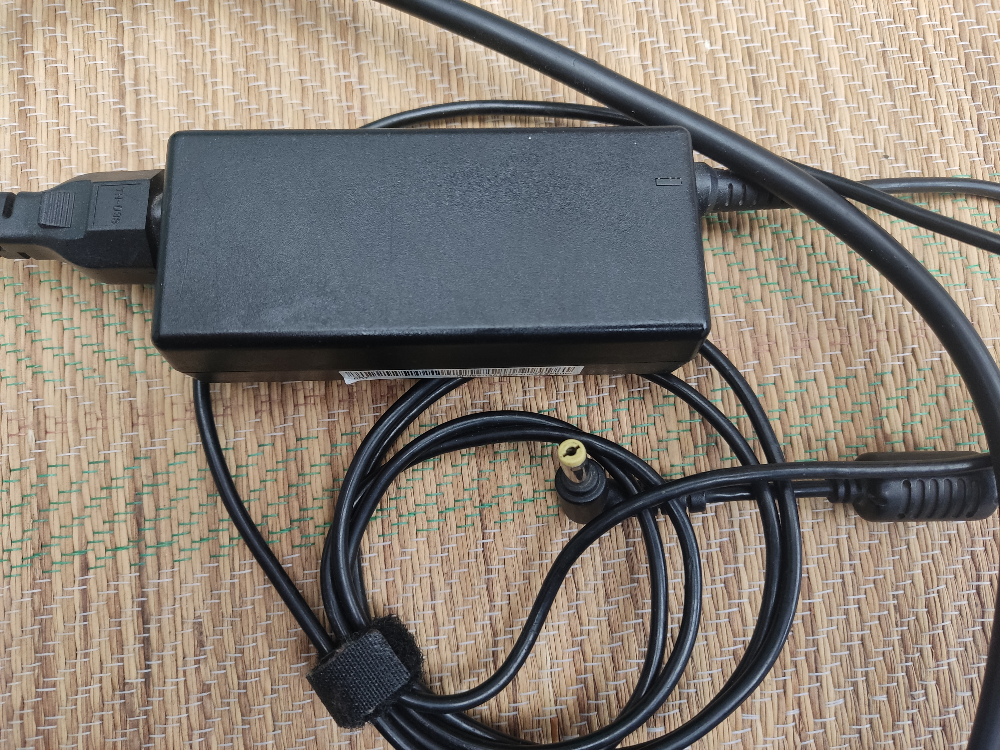

- **Tipo:** Periférico
- **Marca:** Lite-On
- **Modelo:** PA-1650-02 (Adaptador AC 65W)
- **Número de Serie / Activo:** AP06503016824OB7E6P606
- **Fecha de Fabricación / Lanzamiento:** 2008-06
- **Asignación / Ubicación:** Hogar
- **Enlace de Drivers:** [Soporte Oficial Lite-On PA-1650-02 (Adaptador AC 65W)](https://www.acer.com/latam-es/support/product-support/E3-112)
- **Notas:** Cargador del Acer Aspire E3-112-C6ME (S/N NXMRLAL004434177F97600). Entrada 100-240V ~ 1.6A 50-60Hz. Salida 19V ⎓ 3.42A, 65W, centro positivo. Conector de punta amarilla.
- **Observaciones:** Datos de la etiqueta:
• Fabricante: Lite-On Technology Corporation
• Modelo: PA-1650-02
• Entrada: 100-240V ~ 1.6A, 50-60Hz
• Salida: 19V ⎓ 3.42A, 65W (centro positivo)
• Fecha de fabricación: 2008/06
• Etiqueta de serie: 8616796906 · AC · Rev: A06
• Código de barras ADT: AP06503016824OB7E6P606

Compatibilidad: el notebook requiere 19V ⎓ 2.1A; este cargador entrega el mismo voltaje con mayor corriente disponible (3.42A), por lo que es compatible. Por su fecha de fabricación (2008) no es el cargador de fábrica del notebook (2014).

Equipo asociado: Acer Aspire E3-112-C6ME (dev-acer-e3-112).
- **Fotografías:**
  - Vista general con cable y conector: [`img/acer_e3-112_cargador_vista_general.jpg`](img/acer_e3-112_cargador_vista_general.jpg)
  - Etiqueta Lite-On PA-1650-02: [`img/acer_e3-112_cargador_etiqueta_liteon_pa-1650-02.jpg`](img/acer_e3-112_cargador_etiqueta_liteon_pa-1650-02.jpg)
  - Código de barras ADT (serie): [`img/acer_e3-112_cargador_serie_ap06503.jpg`](img/acer_e3-112_cargador_serie_ap06503.jpg)
  - Etiqueta de advertencia de temperatura: [`img/acer_e3-112_cargador_advertencia_temperatura.jpg`](img/acer_e3-112_cargador_advertencia_temperatura.jpg)

### 5. PC armado Core i5-12400F · MSI PRO H610M-G DDR4
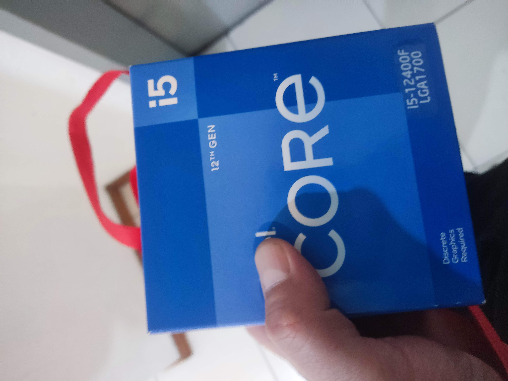

- **Tipo:** Desktop
- **Marca:** PC armado
- **Modelo:** Core i5-12400F · MSI PRO H610M-G DDR4
- **Número de Serie / Activo:** 07D4612_M21D142444
- **Fecha de Fabricación / Lanzamiento:** 2022 (lanzamiento de la plataforma Intel H610)
- **Asignación / Ubicación:** Hogar
- **Especificaciones de Hardware:**
  - **Procesador (CPU):** 12th Gen Intel(R) Core(TM) i5-12400F
    - *Núcleos e Hilos:* 6 núcleos / 12 hilos
    - *Frecuencia:* 2.5 GHz
    - *Año de salida:* 2022
    - *Benchmark PassMark:* multinúcleo 19.524 · mononúcleo 3.483 ([fuente](https://www.cpubenchmark.net/cpu.php?id=4681), 2026-11-01)
  - **Memoria RAM:** 16 GB DDR4
    - *Frecuencia:* 2667 MT/s
    - *Configuración:* 2 de 2 ranuras usadas
  - **Tarjeta Gráfica (GPU):** NVIDIA GeForce GTX 1660 SUPER
    - *Tipo:* **Dedicada**
  - **Almacenamiento:** SSD NVMe 466 GB + HDD SATA 75 GB
- **Enlace de Drivers:** [Soporte Oficial PC armado Core i5-12400F · MSI PRO H610M-G DDR4](https://www.msi.com/Motherboard/PRO-H610M-G-DDR4/support)
- **Notas:** PC de escritorio armado. Placa base MSI PRO H610M-G DDR4 (MS-7D46), Intel Core i5-12400F, 16 GB DDR4 Corsair Vengeance LPX (2 × 8 GB), NVIDIA GeForce GTX 1660 SUPER, SSD WD Blue SN570 500 GB y HDD WD 80 GB. Nombre en red: DESKTOP-QIPN19H. Microsoft Windows 11 Pro (10.0.26200), instalado el 2026-10-01.
- **Observaciones:** El equipo no tiene número de serie propio (PC armado); se usa el número de serie de la placa base como identificador.
La RAM Corsair CMK8GX4M1Z3600C18 es de 3600 MT/s pero funciona a 2667 MT/s: el perfil XMP no está activado en la BIOS. El chipset H610 y el i5-12400F admiten DDR4 hasta 3200 MT/s.
El HDD WDC WD800BD (80 GB) es una unidad antigua; Windows no informa su tipo (se registra como HDD por el modelo).

Registro HomeInfra Collector (2026-10-31 19:21:12):
• BIOS: American Megatrends International, LLC. 1.H0 (2024-03-25)
• CPU: 12th Gen Intel(R) Core(TM) i5-12400F (6 núcleos / 12 hilos socket U3E1)
• RAM: Corsair CMK8GX4M1Z3600C18 8 GB (DDR4 DIMM 2667 MT/s [Controller0-DIMMA1])
• RAM: Corsair CMK8GX4M1Z3600C18 8 GB (DDR4 DIMM 2667 MT/s [Controller1-DIMMB1])
• Almacenamiento: WD Blue SN570 500GB 466 GB (SSD NVMe) · S/N E823_8FA6_BF53_0001_001B_448B_4569_B02C.
• Almacenamiento: WDC WD800BD-22MRA1 75 GB (SATA) · S/N WD-WMAM9AMY4260
• GPU: NVIDIA GeForce GTX 1660 SUPER 4 GB (NVIDIA)
• Red: Intel(R) Ethernet Connection (17) I219-V (MAC 04:7C:16:05:0E:B3)
• Placa base: Micro-Star International Co., Ltd. PRO H610M-G DDR4 (MS-7D46) (1.0) · S/N 07D4612_M21D142444
- **Componentes:**
  - *CPU:* 12th Gen Intel(R) Core(TM) i5-12400F (6 núcleos / 12 hilos socket U3E1) · 2022 · PassMark multi 19.524 / mono 3.483 · reemplazable
  - *RAM:* Corsair CMK8GX4M1Z3600C18 8 GB (DDR4 DIMM 2667 MT/s [Controller0-DIMMA1] · módulo de 3600 MT/s funcionando a 2667 MT/s) · reemplazable
  - *RAM:* Corsair CMK8GX4M1Z3600C18 8 GB (DDR4 DIMM 2667 MT/s [Controller1-DIMMB1] · módulo de 3600 MT/s funcionando a 2667 MT/s) · reemplazable
  - *Almacenamiento:* WD Blue SN570 500GB 466 GB (SSD NVMe) · S/N E823_8FA6_BF53_0001_001B_448B_4569_B02C. · 2021 · reemplazable
  - *Almacenamiento:* WDC WD800BD-22MRA1 75 GB (HDD SATA) · S/N WD-WMAM9AMY4260 · reemplazable
  - *GPU:* NVIDIA GeForce GTX 1660 SUPER 4 GB (NVIDIA) · 2019 · reemplazable
  - *Red:* Intel(R) Ethernet Connection (17) I219-V (MAC 04:7C:16:05:0E:B3) · integrado
  - *Placa base:* Micro-Star International Co., Ltd. PRO H610M-G DDR4 (MS-7D46) (1.0) · S/N 07D4612_M21D142444 · 2022 · integrado
    - Formato: Micro-ATX
    - Socket / chipset: LGA 1700 · Intel H610 (procesadores Intel Core 12.ª, 13.ª y 14.ª gen.)
    - Memoria: 2 ranuras DDR4 · doble canal · hasta 64 GB · 2133 / 2666 / 2933 / 3200 MHz
    - Expansión: 1 × PCIe 4.0 x16 (desde la CPU) · 1 × PCIe 3.0 x1
    - Almacenamiento: 4 × SATA 6 Gb/s · 1 × M.2 Key M PCIe 3.0 x4 (2242 / 2260 / 2280; un SSD M.2 SATA desactiva SATA7)
    - USB: 4 × USB 3.2 Gen 1 5 Gb/s (2 traseros, 2 por conector interno) · 6 × USB 2.0 (4 traseros, 2 internos)
    - Red: Intel I219-V · 1 Gb/s
    - Audio: Realtek ALC892 / ALC897 · 7.1 canales HD
    - Salidas de video: HDMI · VGA · DisplayPort (no funcionan con el i5-12400F, que no tiene gráficos integrados)
    - Panel trasero: PS/2 teclado/ratón · HDMI · VGA · DisplayPort · 2 × USB 3.2 Gen 1 · 4 × USB 2.0 · LAN · audio
    - Fuente: [especificaciones oficiales](https://www.msi.com/Motherboard/PRO-H610M-G-DDR4/Specification) (2026-11-02)
- **Fotografías:**
  - Caja del Intel Core i5-12400F: [`img/intel_i5-12400f_caja.jpg`](img/intel_i5-12400f_caja.jpg)

### 6. PC armado Core 2 Quad Q6700 · ASUS P5G41T-M LX
- **Tipo:** Desktop
- **Marca:** PC armado
- **Modelo:** Core 2 Quad Q6700 · ASUS P5G41T-M LX
- **Número de Serie / Activo:** 107933150000113
- **Fecha de Fabricación / Lanzamiento:** 2008 (lanzamiento del chipset Intel G41)
- **Asignación / Ubicación:** Hogar
- **Especificaciones de Hardware:**
  - **Procesador (CPU):** Intel(R) Core(TM)2 Quad CPU Q6700 @ 2.66GHz
    - *Núcleos e Hilos:* 4 núcleos / 4 hilos
    - *Frecuencia:* 2.7 GHz
    - *Año de salida:* 2007
    - *Características:* Windows informó 2 núcleos / 2 hilos
    - *Benchmark PassMark:* multinúcleo 2.092 · mononúcleo 1.073 ([fuente](https://www.cpubenchmark.net/cpu.php?id=1039), 2026-11-01)
  - **Memoria RAM:** 8 GB DDR3
    - *Configuración:* 2 de 2 ranuras usadas · tipo DDR3 deducido del modelo de placa
  - **Tarjeta Gráfica (GPU):** Intel(R) G41 Express Chipset (Microsoft Corporation - WDDM 1.1)
    - *Tipo:* **Integrada**
  - **Almacenamiento:** Sin disco propio (usa el SSD de Windows compartido)
- **Enlace de Drivers:** [Soporte Oficial PC armado Core 2 Quad Q6700 · ASUS P5G41T-M LX](https://www.asus.com/supportonly/p5g41t-m%20lx/helpdesk_download/)
- **Notas:** PC de escritorio armado. Placa base ASUS P5G41T-M LX (chipset Intel G41), Intel Core 2 Quad Q6700, 8 GB de RAM (2 × 4 GB), gráficos integrados Intel G41 y red Qualcomm Atheros AR8131.
- **Observaciones:** El equipo no tiene número de serie propio (PC armado); se usa el número de serie de la placa base como identificador.
Windows informó 2 núcleos / 2 hilos; el modelo tiene 4 núcleos / 4 hilos según la especificación de Intel. Probablemente el Windows del SSD compartido tiene limitado el número de procesadores (msconfig → Arranque → Opciones avanzadas).
Registrado arrancando con el SSD de Windows compartido (Patriot Burst Elite 120GB) y el monitor LG TV, registrados aparte como dispositivos generales.

Registro HomeInfra Collector (2026-11-01 21:02:05):
• BIOS: American Megatrends Inc. 1101 (2012-06-07)
• CPU: Intel(R) Core(TM)2 Quad CPU Q6700 @ 2.66GHz (2 núcleos / 2 hilos socket LGA775)
• RAM: 4 GB (DIMM [DIMM A1])
• RAM: 4 GB (DIMM [DIMM B1])
• GPU: Intel(R) G41 Express Chipset (Microsoft Corporation - WDDM 1.1) (Intel Corporation)
• Red: Qualcomm Atheros AR8131 PCI-E Gigabit Ethernet Controller (NDIS 6.30) (MAC BC:AE:C5:28:68:F4)
• Placa base: ASUSTeK Computer INC. P5G41T-M LX (Rev X.0x) · S/N 107933150000113
- **Componentes:**
  - *CPU:* Intel(R) Core(TM)2 Quad CPU Q6700 @ 2.66GHz (4 núcleos / 4 hilos socket LGA775) · 2007 · PassMark multi 2.092 / mono 1.073 · reemplazable
  - *RAM:* 4 GB (DDR3 DIMM [DIMM A1] · tipo deducido del modelo de placa) · reemplazable
  - *RAM:* 4 GB (DDR3 DIMM [DIMM B1] · tipo deducido del modelo de placa) · reemplazable
  - *GPU:* Intel(R) G41 Express Chipset (Microsoft Corporation - WDDM 1.1) (Intel Corporation) · 2008 · integrado
  - *Red:* Qualcomm Atheros AR8131 PCI-E Gigabit Ethernet Controller (NDIS 6.30) (MAC BC:AE:C5:28:68:F4) · integrado
  - *Placa base:* ASUSTeK Computer INC. P5G41T-M LX (Rev X.0x) · S/N 107933150000113 · 2008 · integrado
    - Formato: Micro-ATX
    - Socket / chipset: LGA 775 · Intel G41 / ICH7
    - Memoria: 2 ranuras DDR3 · doble canal · hasta 8 GB · 800 / 1066 / 1333 (OC) MHz · no ECC, sin búfer
    - Expansión: 1 × PCIe x16 · 1 × PCIe x1 · 2 × PCI
    - Almacenamiento: 4 × SATA 3 Gb/s · 1 × IDE UltraDMA 100/66/33
    - USB: 8 × USB 2.0 (4 traseros, 4 internos)
    - Red: Qualcomm Atheros Gigabit (Windows informó AR8131)
    - Audio: Realtek ALC887 · 8 canales · S/PDIF Out
    - Salidas de video: VGA (D-Sub) · gráficos integrados Intel G41
    - Fuente: [especificaciones oficiales](https://origin-www.asus.com/Motherboards/P5G41TM_LX/specifications/) (2026-11-02)

### 7. PC armado Core 2 Duo E6750 · ASUS P5Q PRO TURBO
- **Tipo:** Desktop
- **Marca:** PC armado
- **Modelo:** Core 2 Duo E6750 · ASUS P5Q PRO TURBO
- **Número de Serie / Activo:** MS1C93BC3400692
- **Fecha de Fabricación / Lanzamiento:** 2008 (lanzamiento del chipset Intel P45)
- **Asignación / Ubicación:** Hogar
- **Especificaciones de Hardware:**
  - **Procesador (CPU):** Intel(R) Core(TM)2 Duo CPU E6750 @ 2.66GHz
    - *Núcleos e Hilos:* 2 núcleos / 2 hilos
    - *Frecuencia:* 2.7 GHz
    - *Año de salida:* 2007
    - *Benchmark PassMark:* multinúcleo 1.031 · mononúcleo 1.030 ([fuente](https://www.cpubenchmark.net/cpu.php?id=942), 2026-11-01)
  - **Memoria RAM:** 4 GB DDR2
    - *Frecuencia:* 800 MT/s
    - *Configuración:* 2 de 4 ranuras usadas · tipo DDR2 deducido del modelo de placa
  - **Tarjeta Gráfica (GPU):** NVIDIA GeForce 210
    - *Tipo:* **Dedicada**
  - **Almacenamiento:** Sin disco propio (usa el SSD de Windows compartido)
- **Enlace de Drivers:** [Soporte Oficial PC armado Core 2 Duo E6750 · ASUS P5Q PRO TURBO](https://www.asus.com/supportonly/p5q%20pro%20turbo/helpdesk_download/)
- **Notas:** PC de escritorio armado. Placa base ASUS P5Q PRO TURBO (chipset Intel P45), Intel Core 2 Duo E6750, 4 GB de RAM DDR2-800 (2 × 2 GB), NVIDIA GeForce 210 y red Atheros AR8121/AR8113/AR8114.
- **Observaciones:** El equipo no tiene número de serie propio (PC armado); se usa el número de serie de la placa base como identificador.

Registrado arrancando con el SSD de Windows compartido (Patriot Burst Elite 120GB) y el monitor LG TV, registrados aparte como dispositivos generales.

Registro HomeInfra Collector (2026-11-02 00:04:39):
• BIOS: American Megatrends Inc. 0701 (2012-10-07)
• CPU: Intel(R) Core(TM)2 Duo CPU E6750 @ 2.66GHz (2 núcleos / 2 hilos socket LGA 775)
• RAM: 2 GB (DIMM 800 MT/s [DIMM0])
• RAM: 2 GB (DIMM 800 MT/s [DIMM2])
• GPU: NVIDIA GeForce 210 1 GB (NVIDIA)
• Red: Atheros AR8121/AR8113/AR8114 PCI-E Ethernet Controller (MAC 00:24:8C:6B:E7:F6)
• Placa base: ASUSTeK Computer INC. P5Q PRO TURBO (Rev 1.xx) · S/N MS1C93BC3400692
- **Componentes:**
  - *CPU:* Intel(R) Core(TM)2 Duo CPU E6750 @ 2.66GHz (2 núcleos / 2 hilos socket LGA 775) · 2007 · PassMark multi 1.031 / mono 1.030 · reemplazable
  - *RAM:* 2 GB (DDR2 DIMM 800 MT/s [DIMM0] · tipo deducido del modelo de placa) · reemplazable
  - *RAM:* 2 GB (DDR2 DIMM 800 MT/s [DIMM2] · tipo deducido del modelo de placa) · reemplazable
  - *GPU:* NVIDIA GeForce 210 1 GB (NVIDIA) · 2009 · reemplazable
  - *Red:* Atheros AR8121/AR8113/AR8114 PCI-E Ethernet Controller (MAC 00:24:8C:6B:E7:F6) · integrado
  - *Placa base:* ASUSTeK Computer INC. P5Q PRO TURBO (Rev 1.xx) · S/N MS1C93BC3400692 · 2008 · integrado
    - Formato: ATX
    - Socket / chipset: LGA 775 · Intel P45 / ICH10R
    - Memoria: 4 ranuras DDR2 · doble canal · hasta 16 GB · 667 / 800 / 1066 / 1200 / 1300 MHz · no ECC, sin búfer
    - Expansión: 2 × PCIe 2.0 x16 (CrossFireX a x8) · 3 × PCIe x1 · 2 × PCI
    - Almacenamiento: 5 × SATA 3 Gb/s (Intel) · 2 × SATA 3 Gb/s (Silicon Image) · 1 × eSATA y 2 × PATA (JMicron)
    - USB: 12 × USB 2.0 (6 traseros, 6 internos)
    - Red: 1 × RJ45 Gigabit (Windows informó Atheros AR8121/AR8113/AR8114)
    - Audio: VIA VT1708S · 8 canales HD · S/PDIF óptico trasero
    - Salidas de video: Sin gráficos integrados (chipset P45): requiere tarjeta de video
    - Fuente: [especificaciones oficiales](https://origin-www.asus.com/motherboards/p5q_pro_turbo/specifications/) (2026-11-02)

### 8. PC armado Core i7-2600K · Gigabyte Z77-HD3
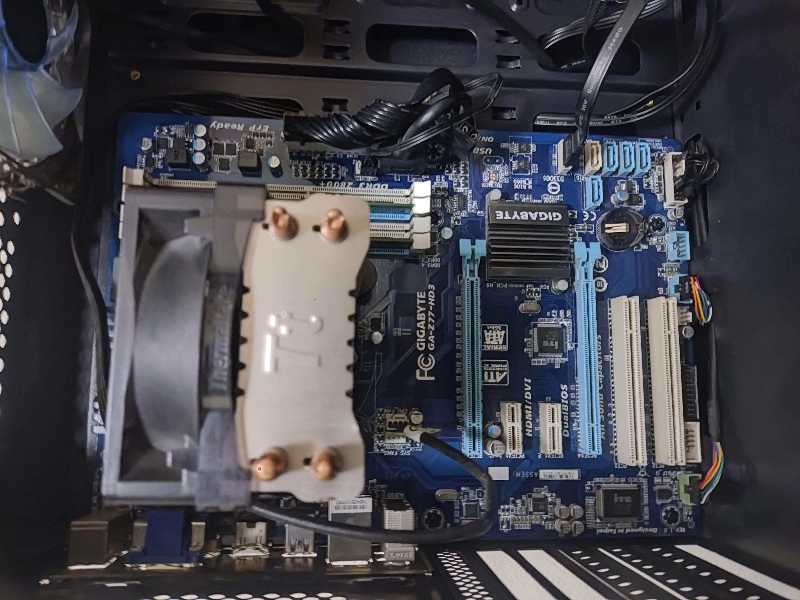

- **Tipo:** Desktop
- **Marca:** PC armado
- **Modelo:** Core i7-2600K · Gigabyte Z77-HD3
- **Número de Serie / Activo:** No registrado
- **Fecha de Fabricación / Lanzamiento:** 2012 (lanzamiento del chipset Intel Z77)
- **Asignación / Ubicación:** Hogar
- **Especificaciones de Hardware:**
  - **Procesador (CPU):** Intel(R) Core(TM) i7-2600K CPU @ 3.40GHz
    - *Núcleos e Hilos:* 4 núcleos / 8 hilos
    - *Frecuencia:* 3.4 GHz
    - *Año de salida:* 2011
    - *Características:* Windows informó 1 núcleos / 2 hilos
    - *Benchmark PassMark:* multinúcleo 5.476 · mononúcleo 1.740 ([fuente](https://www.cpubenchmark.net/cpu.php?id=868), 2026-11-01)
  - **Memoria RAM:** 16 GB DDR3
    - *Frecuencia:* 1600 MT/s
    - *Configuración:* 2 de 4 ranuras usadas
  - **Tarjeta Gráfica (GPU):** Intel(R) HD Graphics 3000
    - *Tipo:* **Integrada**
  - **Almacenamiento:** Sin disco propio (usa el SSD de Windows compartido)
- **Enlace de Drivers:** [Soporte Oficial PC armado Core i7-2600K · Gigabyte Z77-HD3](https://www.gigabyte.com/Motherboard/GA-Z77-HD3-rev-10/support)
- **Notas:** PC de escritorio armado. Placa base Gigabyte Z77-HD3 (chipset Intel Z77), Intel Core i7-2600K, 16 GB DDR3-1600 Kingston HyperX Fury (2 × 8 GB), gráficos integrados Intel HD Graphics 3000 y red Realtek PCIe GbE.
- **Observaciones:** El equipo no tiene número de serie propio y la placa no informa el suyo; se identifica por la MAC de red 74:D4:35:11:F0:AC y el UUID 03D40274-0435-0511-F006-AC0700080009.
Windows informó 1 núcleos / 2 hilos; el modelo tiene 4 núcleos / 8 hilos según la especificación de Intel. Probablemente el Windows del SSD compartido tiene limitado el número de procesadores (msconfig → Arranque → Opciones avanzadas).
Registrado arrancando con el SSD de Windows compartido (Patriot Burst Elite 120GB) y el monitor LG TV, registrados aparte como dispositivos generales.

Registro HomeInfra Collector (2026-11-01 17:53:51):
• BIOS: American Megatrends Inc. F3 (2013-09-24)
• CPU: Intel(R) Core(TM) i7-2600K CPU @ 3.40GHz (1 núcleos / 2 hilos)
• RAM: Kingston HX316C10F/8 8 GB (DDR3 DIMM 1600 MT/s [ChannelB-DIMM1]) · S/N 19FA6341
• RAM: Kingston HX316C10F/8 8 GB (DDR3 DIMM 1600 MT/s [ChannelA-DIMM1]) · S/N 4C33D19F
• GPU: Intel(R) HD Graphics 3000 (Intel Corporation)
• Red: Realtek PCIe GbE Family Controller #2 (MAC 74:D4:35:11:F0:AC)
• Placa base: Gigabyte Technology Co., Ltd. Z77-HD3
- **Componentes:**
  - *CPU:* Intel(R) Core(TM) i7-2600K CPU @ 3.40GHz (4 núcleos / 8 hilos) · 2011 · PassMark multi 5.476 / mono 1.740 · reemplazable
  - *RAM:* Kingston HX316C10F/8 8 GB (DDR3 DIMM 1600 MT/s [ChannelB-DIMM1]) · S/N 19FA6341 · reemplazable
  - *RAM:* Kingston HX316C10F/8 8 GB (DDR3 DIMM 1600 MT/s [ChannelA-DIMM1]) · S/N 4C33D19F · reemplazable
  - *GPU:* Intel(R) HD Graphics 3000 (Intel Corporation) · 2011 · integrado
  - *Red:* Realtek PCIe GbE Family Controller #2 (MAC 74:D4:35:11:F0:AC) · integrado
  - *Placa base:* Gigabyte Technology Co., Ltd. Z77-HD3 · 2012 · integrado
    - Formato: ATX · 30,5 × 21,5 cm
    - Socket / chipset: LGA 1155 · Intel Z77
    - Memoria: 4 ranuras DDR3 1.5V · doble canal · hasta 32 GB · 1066 / 1333 / 1600 MHz (2800 OC); DDR3-1600 requiere CPU Ivy Bridge (22 nm)
    - Expansión: 1 × PCIe 3.0 x16 · 2 × PCIe x1 · 2 × PCI · AMD CrossFire
    - Almacenamiento: 2 × SATA 6 Gb/s (SATA3 0/1) · 4 × SATA 3 Gb/s (SATA2 2–5) · RAID 0 / 1 / 5 / 10
    - USB: Hasta 4 × USB 3.0 (2 traseros, 2 por conector interno) · hasta 8 × USB 2.0
    - Red: Realtek GbE · 10/100/1000 Mb/s
    - Audio: Realtek ALC887 · 2 / 4 / 5.1 / 7.1 canales · S/PDIF Out
    - Salidas de video: D-Sub (VGA) · DVI-D · HDMI (gráficos integrados del procesador)
    - Otros: DualBIOS
    - Fuente: [especificaciones oficiales](https://www.gigabyte.com/Motherboard/GA-Z77-HD3-rev-10/sp) (2026-11-02)
- **Fotografías:**
  - Placa GA-Z77-HD3 en el gabinete, disipador Thermaltake (2022): [`img/gigabyte_z77-hd3_gabinete_2022.jpg`](img/gigabyte_z77-hd3_gabinete_2022.jpg)
  - Placa GA-Z77-HD3 fuera del gabinete (2023): [`img/gigabyte_z77-hd3_placa_2023.jpg`](img/gigabyte_z77-hd3_placa_2023.jpg)

### 9. LG TV (usado como monitor)
- **Tipo:** Monitor
- **Marca:** LG
- **Modelo:** TV (usado como monitor)
- **Número de Serie / Activo:** No registrado
- **Fecha de Fabricación / Lanzamiento:** 2010
- **Asignación / Ubicación:** Hogar
- **Enlace de Drivers:** [Soporte Oficial LG TV (usado como monitor)](https://www.google.com/search?q=LG%20TV%20monitor%20soporte%20oficial)
- **Notas:** Televisor LG usado como monitor compartido entre los PCs de escritorio. Identificado por EDID (fabricante GSM = LG, nombre "LG TV").
- **Observaciones:** Dispositivo general, no forma parte de ningún equipo.

El EDID no entrega un número de serie real (16843009 es un valor de relleno) ni el modelo exacto. Año según EDID: 2010 (2011 al conectarse al PC i5-12400F).

Detectado conectado a:
• Core i5-12400F · MSI PRO H610M-G DDR4 (2026-10-31)
• Core 2 Quad Q6700 · ASUS P5G41T-M LX (2026-11-01)
• Core 2 Duo E6750 · ASUS P5Q PRO TURBO (2026-11-02)
• Core i7-2600K · Gigabyte Z77-HD3 (2026-11-01)

### 10. Patriot Burst Elite 120GB (SSD de Windows compartido)
- **Tipo:** Periférico
- **Marca:** Patriot
- **Modelo:** Burst Elite 120GB (SSD de Windows compartido)
- **Número de Serie / Activo:** PBEIIBB21030118778
- **Fecha de Fabricación / Lanzamiento:** No registrada
- **Asignación / Ubicación:** Hogar
- **Especificaciones de Hardware:**
  - **Almacenamiento:** SSD SATA 120 GB
- **Enlace de Drivers:** [Soporte Oficial Patriot Burst Elite 120GB (SSD de Windows compartido)](https://www.google.com/search?q=Patriot%20Burst%20Elite%20120GB%20SSD%20soporte)
- **Notas:** SSD SATA 2.5" Patriot Burst Elite de 120 GB (111.8 GB útiles), firmware FW200918. Tiene instalado Windows 10 Pro 22H2 (10.0.19045), nombre de equipo "SERVER", instalado el 2025-01-28. Se mueve entre PCs para arrancarlos y registrarlos.
- **Observaciones:** Dispositivo general, no forma parte de ningún equipo.

En los PCs con Core 2 Quad Q6700 y Core i7-2600K, Windows informó menos núcleos de los que tiene el procesador. Probablemente este Windows tiene limitado el número de procesadores (msconfig → Arranque → Opciones avanzadas → Número de procesadores).

Usado para arrancar:
• Core 2 Quad Q6700 · ASUS P5G41T-M LX (2026-11-01)
• Core 2 Duo E6750 · ASUS P5Q PRO TURBO (2026-11-02)
• Core i7-2600K · Gigabyte Z77-HD3 (2026-11-01)

### 11. Patriot Burst Elite 120GB (segunda unidad)
- **Tipo:** Periférico
- **Marca:** Patriot
- **Modelo:** Burst Elite 120GB (segunda unidad)
- **Número de Serie / Activo:** No registrado
- **Fecha de Fabricación / Lanzamiento:** No registrada
- **Asignación / Ubicación:** Hogar
- **Especificaciones de Hardware:**
  - **Almacenamiento:** SSD SATA 120 GB
- **Enlace de Drivers:** [Soporte Oficial Patriot Burst Elite 120GB (segunda unidad)](https://www.google.com/search?q=Patriot%20Burst%20Elite%20120GB%20SSD%20soporte)
- **Notas:** SSD SATA 2.5" Patriot Burst Elite de 120 GB, mismo modelo que el SSD de Windows compartido (S/N PBEIIBB21030118778).
- **Observaciones:** Dispositivo general, no forma parte de ningún equipo.

Número de serie, firmware y contenido pendientes: conectarlo a un PC y ejecutar el HomeInfra Collector, o leer la etiqueta del disco.

### 12. Sony Pendrive USB 4 GB (HomeInfra Collector)
- **Tipo:** Periférico
- **Marca:** Sony
- **Modelo:** Pendrive USB 4 GB (HomeInfra Collector)
- **Número de Serie / Activo:** 7B2211109146005852
- **Fecha de Fabricación / Lanzamiento:** No registrada
- **Asignación / Ubicación:** Hogar
- **Especificaciones de Hardware:**
  - **Almacenamiento:** USB 4 GB
- **Enlace de Drivers:** [Soporte Oficial Sony Pendrive USB 4 GB (HomeInfra Collector)](https://www.google.com/search?q=Sony%20USB%20flash%20drive%20soporte)
- **Notas:** Pendrive USB Sony (Sony Storage Media) de 4 GB (3.8 GB útiles), firmware 0100. Se usa para llevar el HomeInfra Collector y sus registros.
- **Observaciones:** Dispositivo general, no forma parte de ningún equipo.

Detectado en:
• Core i5-12400F · MSI PRO H610M-G DDR4 (2026-10-31)
• Core 2 Quad Q6700 · ASUS P5G41T-M LX (2026-11-01)
• Core 2 Duo E6750 · ASUS P5Q PRO TURBO (2026-11-02)
• Core i7-2600K · Gigabyte Z77-HD3 (2026-11-01)

### 13. ZOTAC GeForce 8400 GS GEN2 512MB DDR2
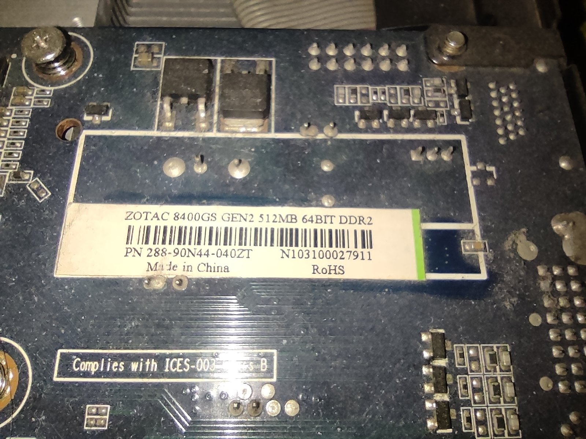

- **Tipo:** Periférico
- **Marca:** ZOTAC
- **Modelo:** GeForce 8400 GS GEN2 512MB DDR2
- **Número de Serie / Activo:** N103100027911
- **Fecha de Fabricación / Lanzamiento:** 2007 (lanzamiento de la GeForce 8400 GS)
- **Asignación / Ubicación:** Hogar
- **Especificaciones de Hardware:**
  - **Tarjeta Gráfica (GPU):** NVIDIA GeForce 8400 GS
    - *Tipo:* **Dedicada**
    - *Características:* 512 MB DDR2 · bus de 64 bits · PCIe (GEN2)
- **Enlace de Drivers:** [Soporte Oficial ZOTAC GeForce 8400 GS GEN2 512MB DDR2](https://www.nvidia.com/Download/index.aspx?lang=es)
- **Notas:** Tarjeta de video ZOTAC NVIDIA GeForce 8400 GS GEN2, 512 MB DDR2, bus de memoria de 64 bits, PCI Express.
- **Observaciones:** Datos de la etiqueta:
• Modelo: ZOTAC 8400GS GEN2 512MB 64BIT DDR2
• PN: 288-90N44-040ZT
• S/N: N103100027911
• Cumple ICES-003 Class B · RoHS

Dispositivo general: no está registrada como componente de ningún equipo.

Año: lanzamiento de la GeForce 8400 GS (2007); la etiqueta no indica fecha de fabricación de esta unidad. Sin imagen comercial disponible (no está en Icecat); se usa la foto local de la etiqueta.
- **Fotografías:**
  - Etiqueta modelo / PN / S/N: [`img/zotac_8400gs_etiqueta.jpg`](img/zotac_8400gs_etiqueta.jpg)
  - Etiqueta (vista cercana): [`img/zotac_8400gs_etiqueta_cercana.jpg`](img/zotac_8400gs_etiqueta_cercana.jpg)

### 14. PC armado MSI A68HM-E33 V2 (CPU AMD por identificar)
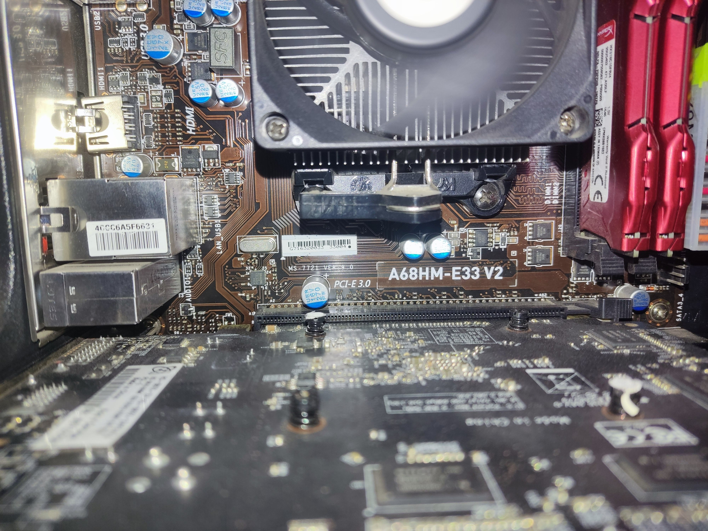

- **Tipo:** Desktop
- **Marca:** PC armado
- **Modelo:** MSI A68HM-E33 V2 (CPU AMD por identificar)
- **Número de Serie / Activo:** G716320033 33004
- **Fecha de Fabricación / Lanzamiento:** 2014 (lanzamiento del chipset AMD A68H)
- **Asignación / Ubicación:** Hogar
- **Especificaciones de Hardware:**
- **Enlace de Drivers:** [Soporte Oficial PC armado MSI A68HM-E33 V2 (CPU AMD por identificar)](https://www.msi.com/Motherboard/A68HM-E33-V2/support)
- **Notas:** PC de escritorio armado con placa base MSI A68HM-E33 V2 (MS-7721 VER 9.0, chipset AMD A68H, socket FM2+), RAM Kingston HyperX Fury DDR3 (rojo) y una tarjeta de video dedicada.
- **Observaciones:** Registrado desde una foto (2024-05-11); pendiente ejecutar el HomeInfra Collector para registrar CPU, RAM total, tarjeta de video y almacenamiento.

Datos legibles en la foto:
• Placa: MSI A68HM-E33 V2 · MS-7721 VER 9.0 · etiqueta G716320033 33004 (se usa como número de serie)
• Etiqueta del puerto de red: 4CCC6A5F6621 (probable MAC 4C:CC:6A:5F:66:21)
• RAM: Kingston HyperX Fury HX318C10FR/4 · 4 GB DDR3-1866 · 1.5V · 9905402-471.A00LF · código 1646 (probablemente semana 46 de 2016). Se ve un segundo módulo HyperX Fury rojo cuya etiqueta no es legible.
• Tarjeta de video dedicada instalada; modelo no identificable en la foto.

Año del equipo: lanzamiento del chipset AMD A68H (2014).
- **Componentes:**
  - *Placa base:* MSI A68HM-E33 V2 (MS-7721) (VER 9.0 · chipset AMD A68H · socket FM2+) · S/N G716320033 33004 · 2014 · integrado
    - Formato: Micro-ATX
    - Socket / chipset: FM2+ · AMD A68H
    - Memoria: 2 ranuras DDR3 · doble canal · hasta 32 GB · 1333 / 1600 / 1866 / 2133 (OC) MHz
    - Expansión: 1 × PCIe 3.0 x16 · 1 × PCIe x1 (2.0 según algunas páginas regionales) · 1 × PCI
    - Almacenamiento: 4 × SATA 6 Gb/s · RAID 0 / 1 / 10
    - USB: 2 × USB 3.0 traseros · 6 × USB 2.0 (2 traseros, 4 internos)
    - Red: Realtek RTL8111G · 10/100/1000 Mb/s
    - Audio: Realtek ALC887 · 3 conectores traseros
    - Salidas de video: VGA (hasta 1920 × 1200 a 60 Hz) · HDMI (gráficos integrados del procesador)
    - Otros: PS/2 teclado y ratón · conector serie interno
    - Fuente: [especificaciones oficiales](https://www.msi.com/Motherboard/a68hm-e33-v2/Specification) (2026-11-02)
  - *RAM:* Kingston HyperX Fury HX318C10FR/4 4 GB (DDR3-1866 CL10 · 1.5V · rojo) · 2016 · reemplazable
  - *RAM:* Kingston HyperX Fury (rojo, etiqueta no legible) (DDR3 · visto en la foto) · reemplazable
  - *GPU:* Tarjeta de video dedicada (por identificar) (Instalada en la ranura PCIe x16) · reemplazable
- **Fotografías:**
  - Placa MSI A68HM-E33 V2 con RAM HyperX Fury (2024): [`img/msi_a68hm-e33_v2_placa.jpg`](img/msi_a68hm-e33_v2_placa.jpg)

### 15. Western Digital WD Blue 1TB WD10SPZX (marcado 1)
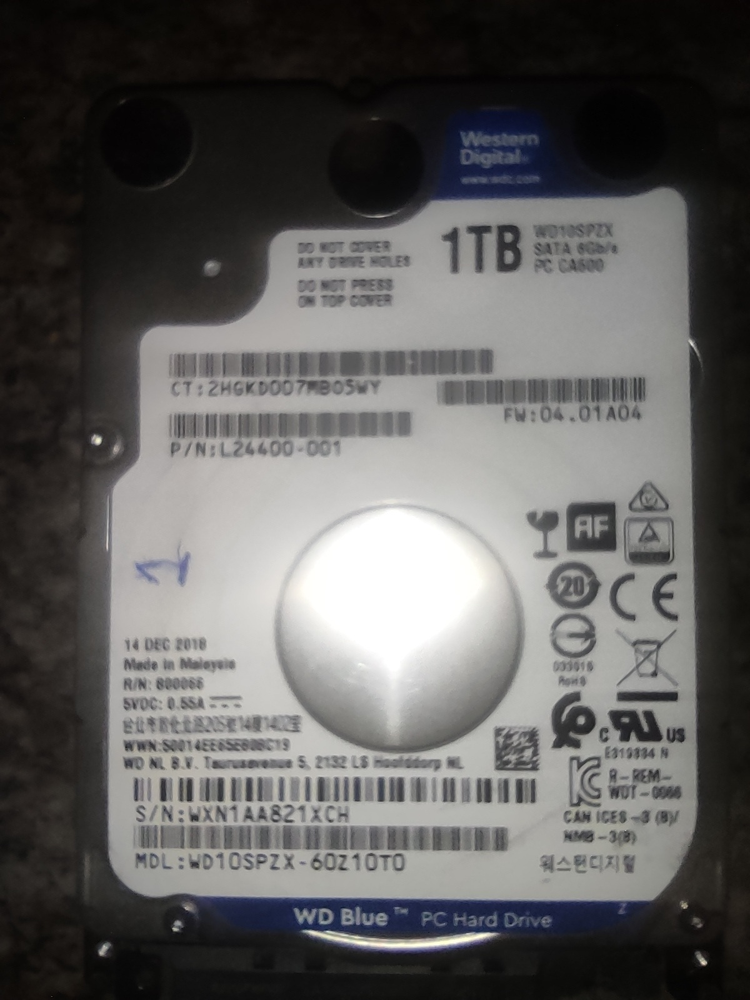

- **Tipo:** Periférico
- **Marca:** Western Digital
- **Modelo:** WD Blue 1TB WD10SPZX (marcado 1)
- **Número de Serie / Activo:** WXN1AA821XCH
- **Fecha de Fabricación / Lanzamiento:** 2018-12-14
- **Asignación / Ubicación:** Hogar
- **Especificaciones de Hardware:**
  - **Almacenamiento:** HDD SATA 6 Gb/s 1 TB 2.5" 5400 rpm
- **Enlace de Drivers:** [Soporte Oficial Western Digital WD Blue 1TB WD10SPZX (marcado 1)](https://www.westerndigital.com/support)
- **Notas:** Disco duro 2.5" WD Blue de 1 TB, SATA 6 Gb/s, 5400 rpm (Advanced Format). Marcado a mano con "1".
- **Observaciones:** Datos de la etiqueta:
• MDL: WD10SPZX-60Z10T0 · S/N: WXN1AA821XCH
• Fecha: 14 DEC 2018 · FW: 04.01A04 · R/N: 800066
• HP P/N: L24400-001 (disco de un equipo HP)

Dispositivo general: no está registrado como componente de ningún equipo.
- **Fotografías:**
  - Etiqueta: [`img/hdd_wd10spzx_1tb_etiqueta.jpg`](img/hdd_wd10spzx_1tb_etiqueta.jpg)
  - Etiqueta (otra toma): [`img/hdd_wd10spzx_1tb_etiqueta_b.jpg`](img/hdd_wd10spzx_1tb_etiqueta_b.jpg)

### 16. Western Digital WD Blue 1TB WD10JPVX (marcado 2)
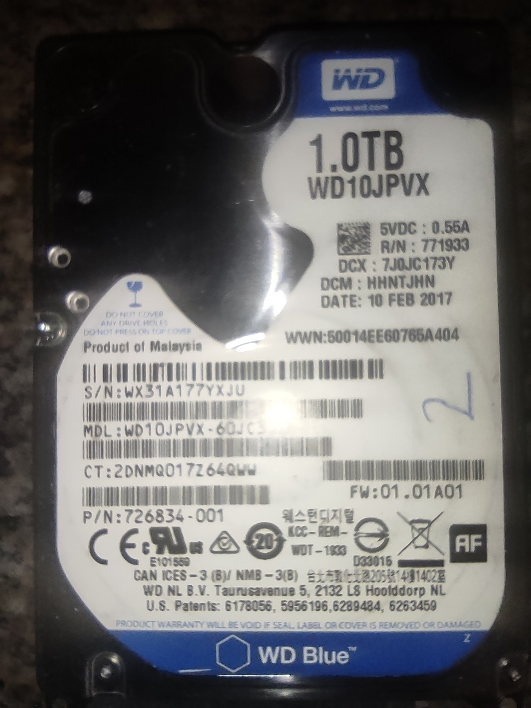

- **Tipo:** Periférico
- **Marca:** Western Digital
- **Modelo:** WD Blue 1TB WD10JPVX (marcado 2)
- **Número de Serie / Activo:** WX31A177YXJU
- **Fecha de Fabricación / Lanzamiento:** 2017-02-10
- **Asignación / Ubicación:** Hogar
- **Especificaciones de Hardware:**
  - **Almacenamiento:** HDD SATA 6 Gb/s 1 TB 2.5" 5400 rpm
- **Enlace de Drivers:** [Soporte Oficial Western Digital WD Blue 1TB WD10JPVX (marcado 2)](https://www.westerndigital.com/support)
- **Notas:** Disco duro 2.5" WD Blue de 1 TB, SATA 6 Gb/s, 5400 rpm (Advanced Format). Marcado a mano con "2".
- **Observaciones:** Datos de la etiqueta:
• MDL: WD10JPVX-60JC3T0 · S/N: WX31A177YXJU
• Fecha: 10 FEB 2017 · FW: 01.01A01 · DCM: HHNTJHN
• HP P/N: 726834-001 (disco de un equipo HP)

Dispositivo general: no está registrado como componente de ningún equipo.
- **Fotografías:**
  - Etiqueta: [`img/hdd_wd10jpvx_1tb_etiqueta.jpg`](img/hdd_wd10jpvx_1tb_etiqueta.jpg)

### 17. Seagate (Samsung) Spinpoint M8 1TB ST1000LM024 (marcado 3)
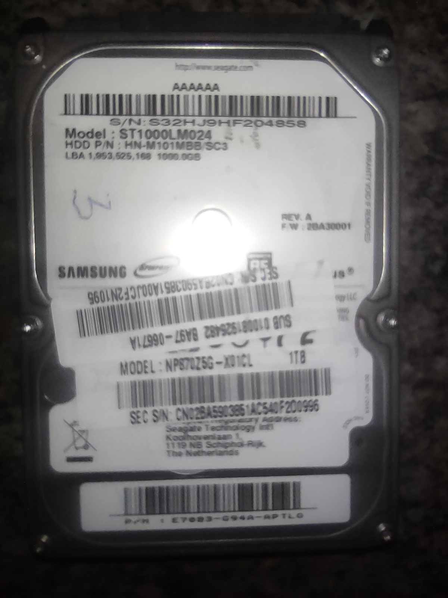

- **Tipo:** Periférico
- **Marca:** Seagate (Samsung)
- **Modelo:** Spinpoint M8 1TB ST1000LM024 (marcado 3)
- **Número de Serie / Activo:** S32HJ9HF204858
- **Fecha de Fabricación / Lanzamiento:** 2011 (lanzamiento de la serie Spinpoint M8)
- **Asignación / Ubicación:** Hogar
- **Especificaciones de Hardware:**
  - **Almacenamiento:** HDD SATA 3 Gb/s 1 TB 2.5" 5400 rpm
- **Enlace de Drivers:** [Soporte Oficial Seagate (Samsung) Spinpoint M8 1TB ST1000LM024 (marcado 3)](https://www.seagate.com/support/)
- **Notas:** Disco duro 2.5" Samsung Spinpoint M8 de 1 TB (fabricado por Seagate tras comprar la división de discos de Samsung), SATA 3 Gb/s, 5400 rpm. Marcado a mano con "3".
- **Observaciones:** Datos de la etiqueta:
• Model: ST1000LM024 · HDD P/N: HN-M101MBB/SC3 · S/N: S32HJ9HF204858
• REV. A · F/W: 2BA30001 · LBA 1.953.525.168 (1000.0 GB)
• Etiqueta Samsung: MODEL NP870Z5G-X01CL 1TB · SEC S/N CN02BA5903851AC540F2D0996 (disco de un laptop Samsung NP870Z5G)

Sin imagen comercial que lo identifique; se usa la foto de la etiqueta.

Dispositivo general: no está registrado como componente de ningún equipo.
- **Fotografías:**
  - Etiqueta: [`img/hdd_st1000lm024_1tb_etiqueta.jpg`](img/hdd_st1000lm024_1tb_etiqueta.jpg)

### 18. Toshiba MQ01ACF050 500GB
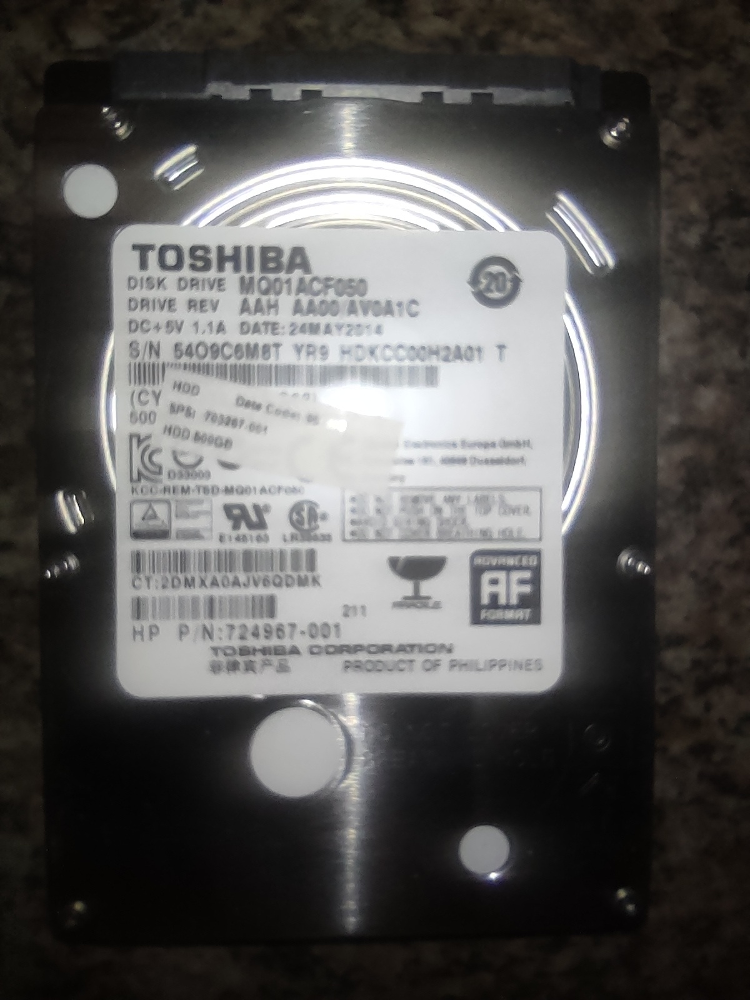

- **Tipo:** Periférico
- **Marca:** Toshiba
- **Modelo:** MQ01ACF050 500GB
- **Número de Serie / Activo:** 54O9C6M8T
- **Fecha de Fabricación / Lanzamiento:** 2014-05-24
- **Asignación / Ubicación:** Hogar
- **Especificaciones de Hardware:**
  - **Almacenamiento:** HDD SATA 6 Gb/s 500 GB 2.5" 7200 rpm
- **Enlace de Drivers:** [Soporte Oficial Toshiba MQ01ACF050 500GB](https://www.toshiba-storage.com/)
- **Notas:** Disco duro 2.5" Toshiba de 500 GB, SATA 6 Gb/s, 7200 rpm, 7 mm (Advanced Format).
- **Observaciones:** Datos de la etiqueta:
• Disk drive: MQ01ACF050 · Drive rev: AAH AA00/AV0A1C · DC+5V 1.1A
• Fecha: 24 MAY 2014 · S/N: 54O9C6M8T (lectura de la foto; confirmar O/0) · YR9 HDKCC00H2A01 T
• HP P/N: 724967-001 · HP SPS: 703267-001 (disco de un equipo HP)

Dispositivo general: no está registrado como componente de ningún equipo.
- **Fotografías:**
  - Etiqueta: [`img/hdd_toshiba_mq01acf050_500gb_etiqueta.jpg`](img/hdd_toshiba_mq01acf050_500gb_etiqueta.jpg)

### 19. Western Digital WD Blue 750GB WD7500BPVT
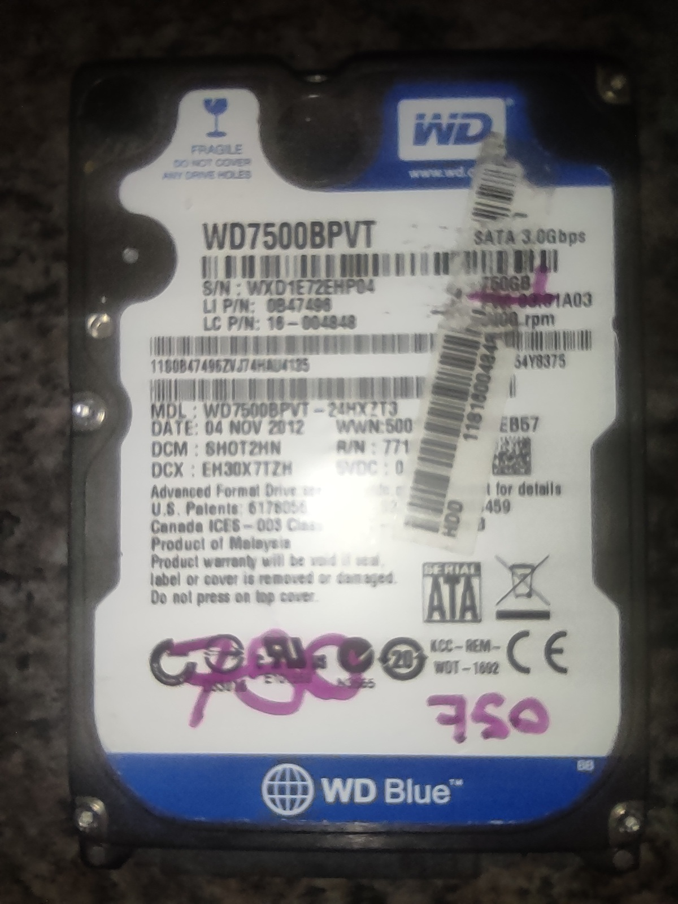

- **Tipo:** Periférico
- **Marca:** Western Digital
- **Modelo:** WD Blue 750GB WD7500BPVT
- **Número de Serie / Activo:** WXD1E72EHP04
- **Fecha de Fabricación / Lanzamiento:** 2012-11-04
- **Asignación / Ubicación:** Hogar
- **Especificaciones de Hardware:**
  - **Almacenamiento:** HDD SATA 3 Gb/s 750 GB 2.5" 5400 rpm
- **Enlace de Drivers:** [Soporte Oficial Western Digital WD Blue 750GB WD7500BPVT](https://www.westerndigital.com/support)
- **Notas:** Disco duro 2.5" WD Blue de 750 GB, SATA 3 Gb/s, 5400 rpm (Advanced Format). Marcado a mano con "750".
- **Observaciones:** Datos de la etiqueta:
• MDL: WD7500BPVT-24HXZT3 · S/N: WXD1E72EHP04
• Fecha: 04 NOV 2012 · DCM: SHOT2HN · DCX: EH30X7TZH
• Lenovo LI P/N: 0B47496 · LC P/N: 16-004848 (disco de un equipo Lenovo)

Dispositivo general: no está registrado como componente de ningún equipo.
- **Fotografías:**
  - Etiqueta: [`img/hdd_wd7500bpvt_750gb_etiqueta.jpg`](img/hdd_wd7500bpvt_750gb_etiqueta.jpg)

### 20. Samsung SSD 850 EVO 500GB
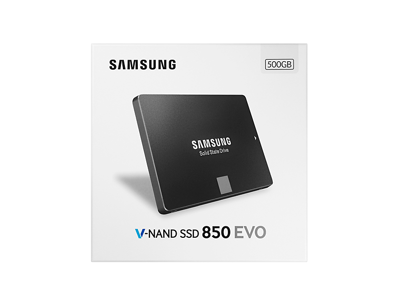

- **Tipo:** Periférico
- **Marca:** Samsung
- **Modelo:** SSD 850 EVO 500GB
- **Número de Serie / Activo:** S21HNXAGA21889H
- **Fecha de Fabricación / Lanzamiento:** 2014 (lanzamiento del 850 EVO)
- **Asignación / Ubicación:** Hogar
- **Especificaciones de Hardware:**
  - **Almacenamiento:** SSD SATA 6 Gb/s 500 GB 2.5"
- **Enlace de Drivers:** [Soporte Oficial Samsung SSD 850 EVO 500GB](https://semiconductor.samsung.com/consumer-storage/support/tools/)
- **Notas:** SSD SATA 2.5" Samsung 850 EVO de 500 GB (V-NAND), SATA 6 Gb/s.
- **Observaciones:** Datos de la etiqueta:
• Model: MZ-75E500 · P/N: MZ7LN500 · S/N: S21HNXAGA21889H
• WWN: 5002538D4067BD4x (último carácter no legible)

Imagen principal: comercial (Icecat, 850 EVO 500GB); la foto de la etiqueta está en la galería.

Dispositivo general: no está registrado como componente de ningún equipo.
- **Fotografías:**
  - Imagen comercial (Icecat): [`img/componente_ssd_samsung_850evo_500gb.jpg`](img/componente_ssd_samsung_850evo_500gb.jpg)
  - Etiqueta: [`img/ssd_samsung_850evo_500gb_etiqueta.jpg`](img/ssd_samsung_850evo_500gb_etiqueta.jpg)

### 21. Inspur Tarjeta RAID/HBA SAS 6Gb/s YZCA-00019-101 (chip LSI)
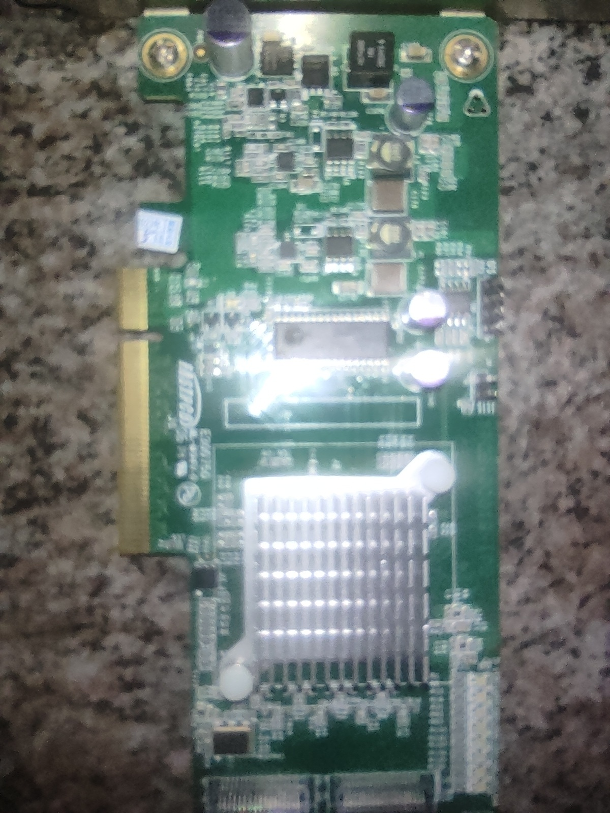

- **Tipo:** Periférico
- **Marca:** Inspur
- **Modelo:** Tarjeta RAID/HBA SAS 6Gb/s YZCA-00019-101 (chip LSI)
- **Número de Serie / Activo:** QTE227E00948A07
- **Fecha de Fabricación / Lanzamiento:** No registrada
- **Asignación / Ubicación:** Hogar
- **Enlace de Drivers:** [Soporte Oficial Inspur Tarjeta RAID/HBA SAS 6Gb/s YZCA-00019-101 (chip LSI)](https://www.broadcom.com/support/download-search)
- **Notas:** Controladora PCIe SAS/SATA de 6 Gb/s y 8 puertos, con chip LSI, para servidores Inspur (ej. NF5240M3). Perfil bajo, con disipador.
- **Observaciones:** Datos de la etiqueta:
• PN: (Y)ZCA-00019-101 · QN: QTE227E00948A07 (se usa como número de serie)
• Dirección SAS: 56C92BF000040116

Identificación según vendedores (no hay documentación oficial de Inspur): controladora LSI de 8 puertos SAS/SATA a 6 Gb/s, vendida como LSI 9240-8i (RAID 0/1/5, firmware IR) o como 9211-8i (HBA, firmware IT). El modo depende del firmware instalado; confirmarlo al conectarla.

Dispositivo general: no está registrado como componente de ningún equipo.
- **Fotografías:**
  - Vista de la tarjeta: [`img/raid_inspur_yzca-00019-101_tarjeta.jpg`](img/raid_inspur_yzca-00019-101_tarjeta.jpg)
  - Etiquetas PN / QN / SAS: [`img/raid_inspur_yzca-00019-101_etiqueta.jpg`](img/raid_inspur_yzca-00019-101_etiqueta.jpg)

---

## 🛠️ Guía de Uso del Inventario y Driver Hub
1. **Base de Datos:** El archivo [`equipos.json`](equipos.json) almacena los registros de los equipos, imágenes de referencia, especificaciones de hardware, credenciales y observaciones.
2. **Abrir la Aplicación:** Abre `index.html` en cualquier navegador web.
3. **Registro y Edición:** Pulsa en **"Registrar Equipo"** o en el botón de **Editar** (icono de lápiz) en cualquier tarjeta para modificar cualquier campo en cualquier momento.
4. **Acceso Rápido a Drivers:** Desde la tarjeta de cada equipo, el botón **"Descargar Drivers & Soporte"** te llevará directamente a la página oficial de descargas del fabricante.
5. **Sincronización:** Usa el botón **"Descargar contexto.md"**, **"Sincronizar contexto.md"** o **"Copiar Markdown"** en la barra superior para actualizar este archivo cada vez que ingreses o modifiques equipos.
6. **HomeInfra Collector:** El botón **"Collector"** muestra el comando para recolectar los datos de un equipo en Windows, Linux o macOS, y permite importar los registros `.json` generados (varios a la vez). El script también puede llevarse en un pendrive desde la carpeta [`Collector`](Collector/README.md).
7. **Equipos nuevos desde equipos.json:** Al abrir la app, los equipos de `equipos.json` que el navegador aún no conoce se agregan solos; los eliminados desde la app no vuelven a aparecer.
